# Guia rápido: um ciclo completo do PEI Vivo em 10 minutos

**Gravado em:** 14/10/2026, com o sistema rodando em `http://localhost:5179` no modo demonstração. Todos os dados são **fictícios** e nenhum perfil pede senha.
**Para quem é:** quem vai apresentar ou testar o sistema pela primeira vez. O guia completo, com todos os perfis e telas, está em [`../guia-de-uso-do-sistema.md`](../guia-de-uso-do-sistema.md).

Neste guia, a professora registra o que viu em sala, gera e aprova um material, e fecha o ciclo. Depois, a profissional de saúde valida os parâmetros, e a família acompanha tudo pelo histórico.

## Antes de começar

```bash
npm install                                    # só na primeira vez
cd apps/web && VITE_API=mock npx vite --port 5179
```

Abra <http://localhost:5179>.
- `VITE_API=mock` liga o modo demonstração, mesmo que o `apps/web/.env.local` aponte para o Supabase real.
- A porta 5173 desta máquina é usada por outro projeto, por isso o comando usa a 5179.
- Para voltar ao estado inicial, entre em **Ajuda → Restaurar dados da demonstração**.

---

## 1. Escolher o perfil

Em **Entrar**, cada perfil tem a sua porta: Família, Professores, Equipe de saúde e Coordenação. Cada porta explica o que aquele perfil faz no sistema e o que ele **nunca vê**.

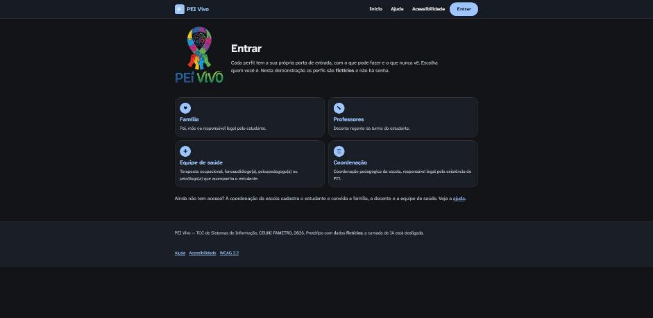

## 2. Professora: ver os estudantes

Entre em **Professores → Márcia (fictícia)**. O painel mostra só os estudantes vinculados a ela.
- O Miguel tem consentimento ativo, então tem o botão **Gerar material**.
- O "Estudante fictício B" ainda espera o consentimento da família, por isso a professora não consegue fazer nada nele.

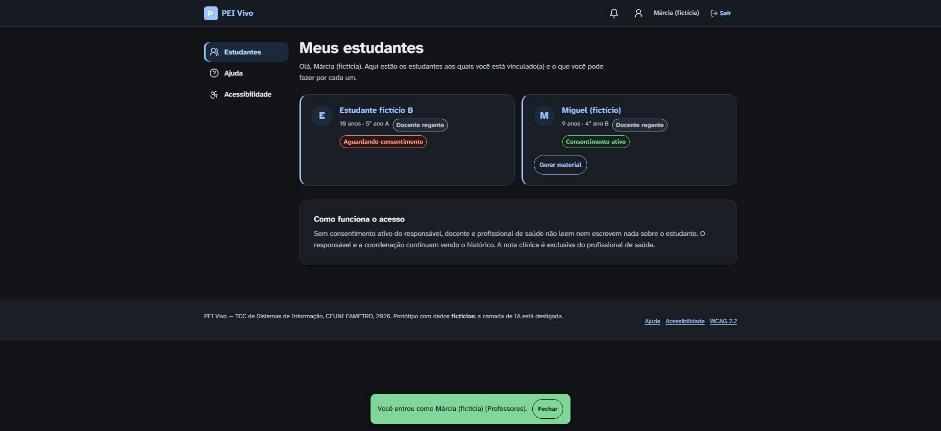

## 3. Professora: registrar a observação quinzenal

Clique em **Miguel → Registrar observação → Abrir novo ciclo**. São seis dimensões, e em cada uma a professora marca **Reduzida**, **Estável** ou **Ampliada** em relação ao ciclo anterior. A evidência é opcional e descreve só o que ela viu, nunca um diagnóstico.

Neste exemplo, a atenção ficou "Ampliada", com a evidência *"Leu o texto sobre dinossauros até o fim sem pausar."*, e as demais dimensões ficaram "Estável". Ao clicar em **Registrar observações**, o sistema confirma: *6 observações registradas no ciclo 4*.

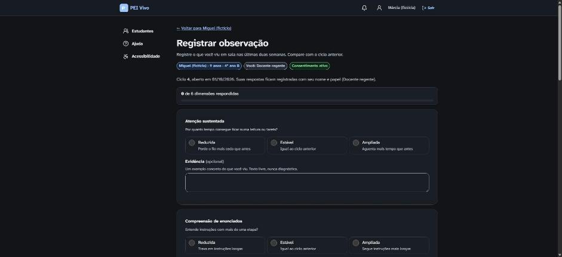

## 4. Professora: gerar o material adaptado

Clique em **Gerar material**. A tela mostra no topo o perfil vigente (4 linhas por bloco, etapa única, contraste 7:1, âncora "dinossauros").
- Para a demonstração, use **Usar texto de exemplo (ciclo da água)** e depois **Adaptar para Miguel**.

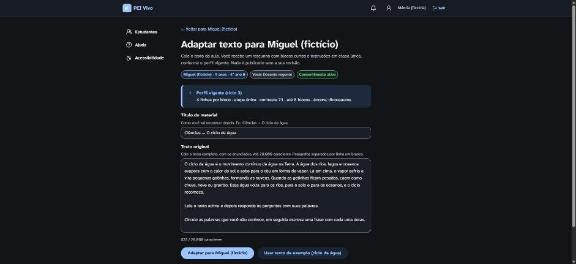

Em poucos segundos aparece um **rascunho** com o original e a versão adaptada lado a lado. Os blocos são curtos, cada um com o botão **Ouvir**, e as instruções vêm numeradas, uma etapa por vez. O aviso explica que a camada de IA está desligada, por isso só as regras fixas foram aplicadas.

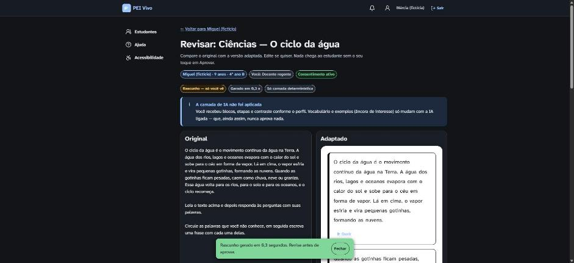

Clique em **Aprovar material**. Nenhum material chega ao estudante sem a aprovação da professora. Depois de aprovado, família, profissional e coordenação também passam a ver o material.

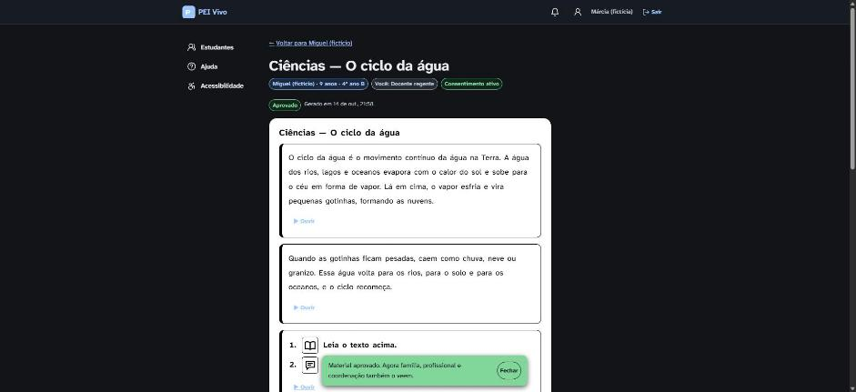

## 5. Professora: fechar o ciclo

Clique em **Miguel → Fechar ciclo**. O sistema transforma as observações em uma **proposta de parâmetros** e mostra o que mudaria.

Repare em **Linhas por bloco: "Aguardando 2º ciclo para elevar"**. Uma melhora só aumenta a exigência depois de 2 ciclos seguidos, mas uma piora reduz na hora. Assim o sistema erra a favor do material mais acessível.

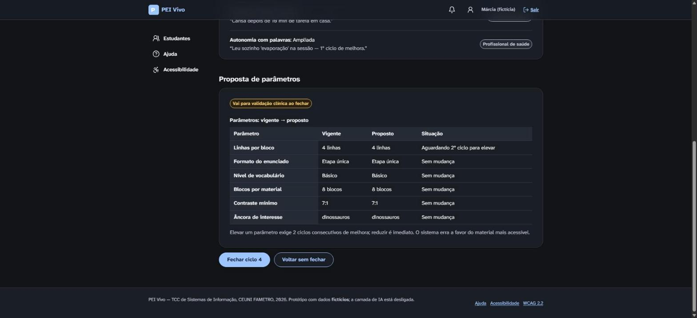

Confirme em **Fechar ciclo 4**. A proposta vai para a validação clínica e, até ser validada, os materiais continuam usando a versão anterior.

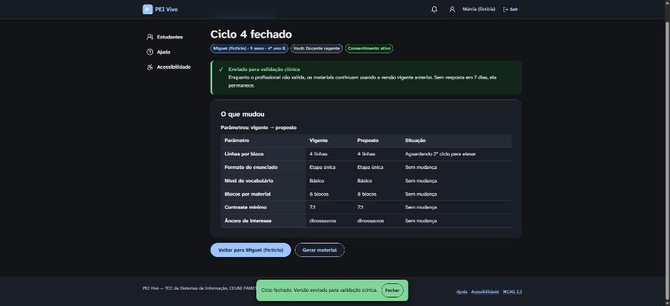

## 6. Equipe de saúde: validar os parâmetros

Clique em **Sair** e entre em **Equipe de saúde → Camila (fictícia)**. O sino mostra uma notificação, e o menu ganha o item **Pendências**. Clique em **Miguel → Validar parâmetros**.

A profissional valida o **conjunto de parâmetros do ciclo**, nunca um material isolado. Se ela não responder em 7 dias, a proposta expira e a versão anterior continua valendo.

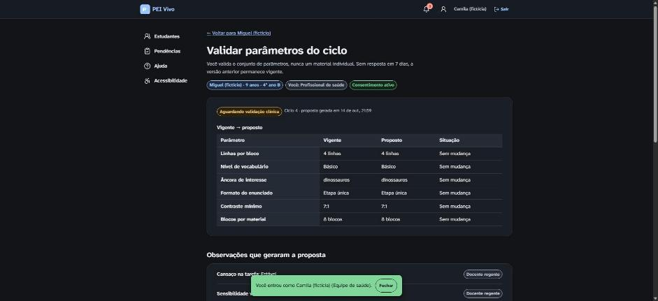

Clique em **Aprovar o conjunto de parâmetros**. A versão do ciclo 4 passa a **Vigente**, e as anteriores ficam marcadas como "Substituída por uma versão mais nova".

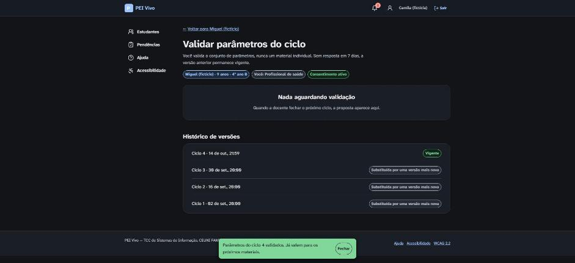

## 7. Família: acompanhar e controlar

Clique em **Sair** e entre em **Família → Rosa (fictícia)**. Na página do Miguel, a responsável encontra:
- **Privacidade**: quem tem acesso a quê.
- **Consentimento**: pode revogar quando quiser, e a geração de material para na hora.
- **Observação de casa**.
- **Meus dados**: exportar ou excluir tudo, conforme a LGPD.
- **Histórico**.

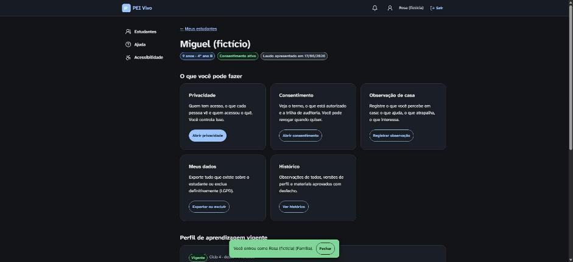

Em **Histórico**, a família vê o ciclo inteiro que acabamos de fazer, com as observações, a versão do perfil e o material. No fim fica a **trilha de auditoria**: *material aprovado pela docente → ciclo fechado → parâmetros validados pelo profissional*. A nota clínica não aparece aqui, porque ela é exclusiva da equipe de saúde.

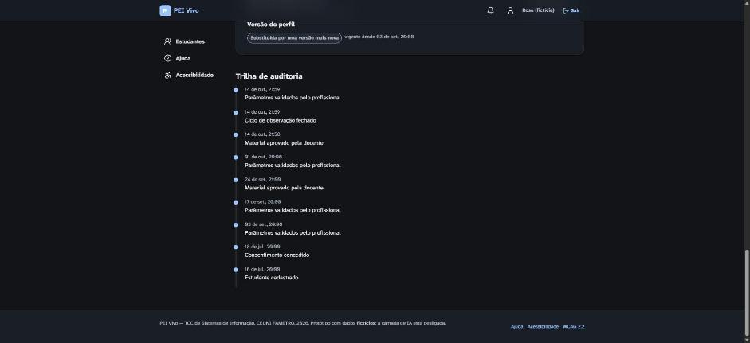

---

## O que este percurso demonstra

| Etapa | Regra do sistema que aparece na tela |
|---|---|
| 2 | Sem consentimento ativo, nada é escrito nem gerado para o estudante |
| 4 | Nenhum material chega ao estudante sem a aprovação da professora |
| 4 | Sem profissional de saúde vinculado, ou com a IA desligada, só rodam as regras fixas |
| 5 | Subir um parâmetro exige 2 ciclos de melhora; reduzir é imediato |
| 5–6 | Sem validação em 7 dias, a proposta expira e a versão vigente continua |
| 6 | A validação clínica vale para o ciclo inteiro, nunca para um material isolado |
| 7 | A família pode revogar o consentimento a qualquer momento; a nota clínica nunca aparece para a família nem para a escola |
