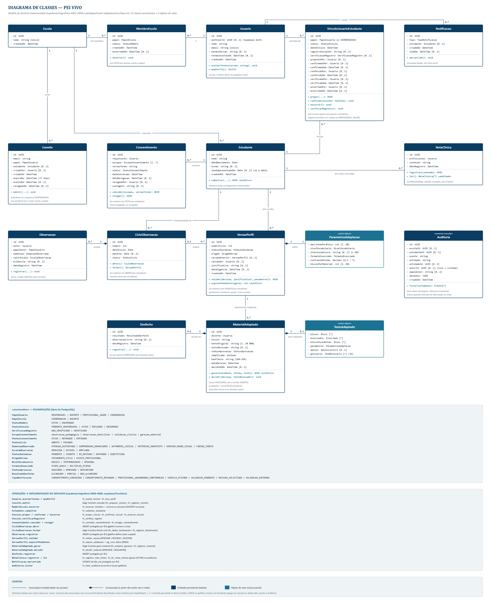
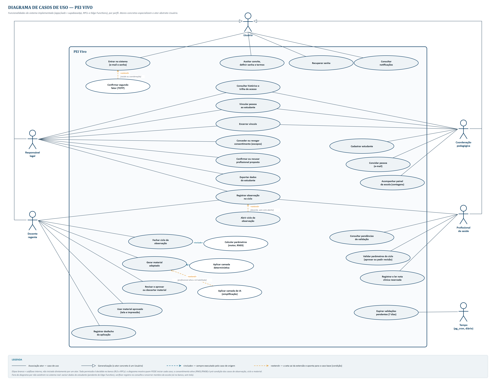
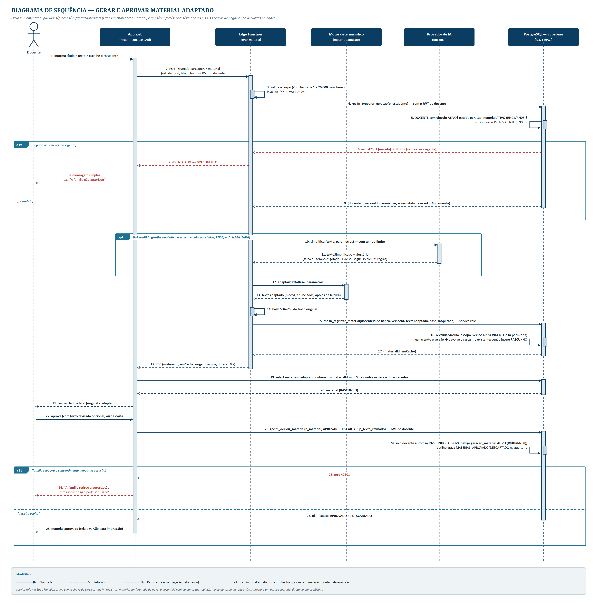
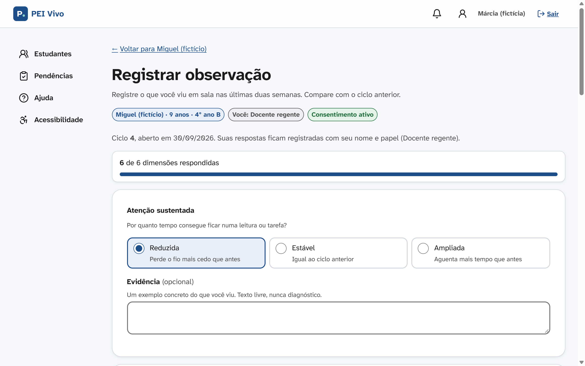
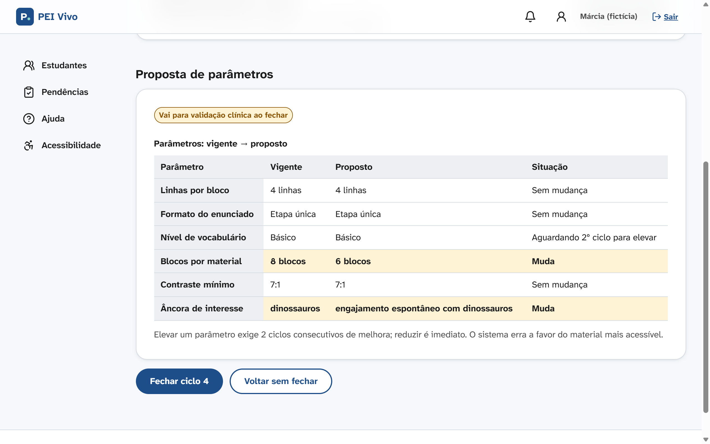
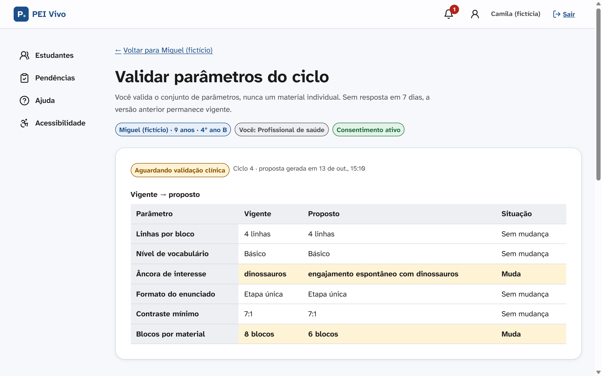
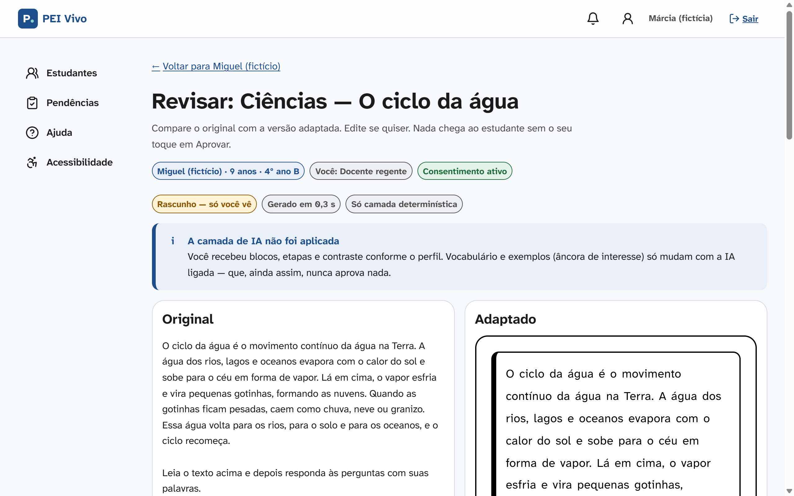
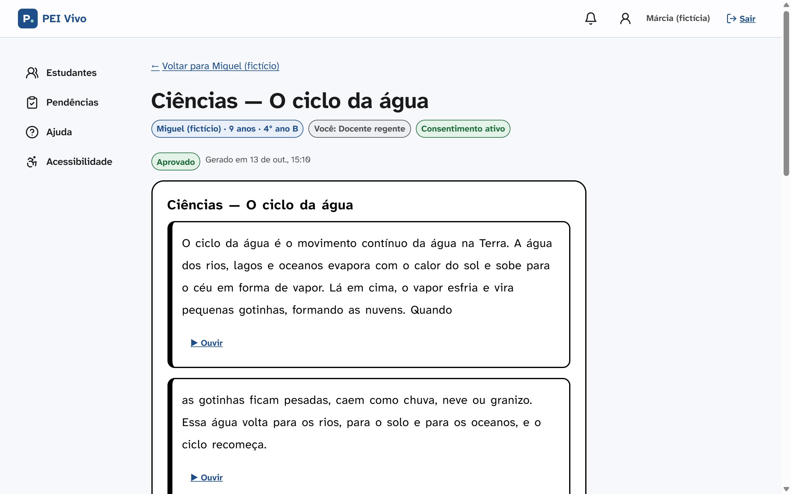
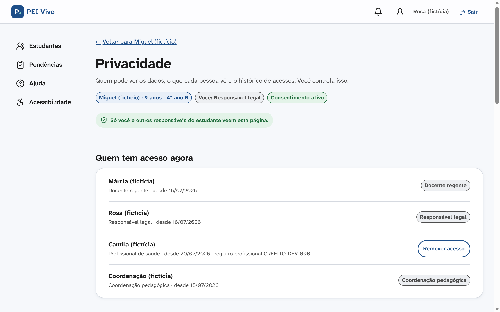
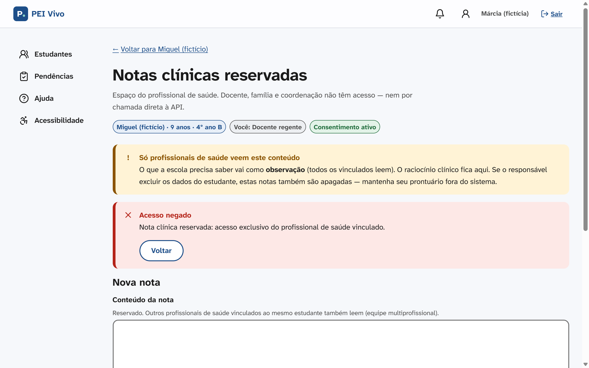

<!--
Fonte do artigo (versão 2, 13/10/2026). Gera o .docx com:
  python scripts/artigo/gerar_docx.py
Marcadores [PREENCHER: …] e [CONFERIR: …] saem destacados em amarelo no .docx:
são dados que só a dupla tem (validação com usuários, divisão de tarefas, URLs
e datas de acesso) e não podem ser inventados. Remova cada marcador ao preencher.
Capa e folha de rosto são montadas pelo script (constantes no topo dele).
-->

# PEI VIVO: SISTEMA WEB PARA ADAPTAÇÃO CONTÍNUA DE MATERIAL DIDÁTICO A PARTIR DE OBSERVAÇÕES PEDAGÓGICAS VALIDADAS POR PROFISSIONAL DE SAÚDE

@autores

## RESUMO

O Plano Educacional Individualizado (PEI), previsto na Lei Brasileira de Inclusão, tende a se tornar um documento estático, elaborado uma vez por período letivo e pouco traduzido em material didático. Este artigo técnico apresenta o PEI Vivo, sistema web que organiza um ciclo quinzenal em que docente, família e profissional de saúde registram observações em seis dimensões, um motor de regras determinísticas converte essas observações em parâmetros de adaptação, o profissional de saúde valida o conjunto de parâmetros e o docente gera, revisa e aprova o material adaptado. A pesquisa é aplicada e segue a Design Science Research. O sistema foi construído em TypeScript, com interface React e banco PostgreSQL na plataforma Supabase, em que as permissões são aplicadas por Row Level Security e por funções do próprio banco. Como resultados, o protótipo reúne 31 telas, 8 migrações com 15 tabelas e 302 testes automatizados aprovados, além de 20 testes ponta a ponta. As 31 tentativas de acesso indevido catalogadas foram todas bloqueadas pelo banco, inclusive no ambiente real de nuvem. A avaliação com usuários finais [PREENCHER: resultado do SUS e n participantes, ou "permanece como etapa seguinte"]. Conclui-se que a integração entre escola, família e saúde é tecnicamente viável com proteção de dados aplicada na camada de dados, e que o valor percebido pelos usuários ainda depende de validação empírica.

**Palavras-chave:** Educação inclusiva; Plano Educacional Individualizado; Adaptação de material didático; Controle de acesso; LGPD.

## ABSTRACT

The Individualized Education Plan (PEI) required by Brazilian inclusion law often becomes a static document that is rarely turned into teaching material. This technical paper presents PEI Vivo, a web system that runs a biweekly cycle in which teachers, families and health professionals record observations on six dimensions; a deterministic rule engine converts them into adaptation parameters; a health professional validates the parameter set; and the teacher generates, reviews and approves the adapted material. The research is applied and follows Design Science Research. The system was built in TypeScript with React and PostgreSQL on Supabase, enforcing permissions through Row Level Security and database functions. The prototype has 31 screens, 8 migrations with 15 tables, 302 passing automated tests and 20 end-to-end tests; all 31 catalogued unauthorized-access attempts were blocked by the database, including in the cloud environment. User evaluation [PREENCHER: SUS result, or "remains the next step"]. Integrating school, family and health is technically feasible with data protection enforced at the data layer; perceived value still requires empirical validation.

**Keywords:** Inclusive education; Individualized Education Plan; Adaptive learning materials; Access control; Data protection.

# 1. INTRODUÇÃO

O crescimento das matrículas da Educação Especial no Brasil evidencia um avanço expressivo no acesso à escolarização de estudantes com deficiência e transtornos do neurodesenvolvimento: em 2025, essas matrículas alcançaram 2,5 milhões, um aumento de 82% em relação a 2021, com mais de 90% dos estudantes já inseridos em classes comuns do ensino regular (INSTITUTO NACIONAL DE ESTUDOS E PESQUISAS EDUCACIONAIS ANÍSIO TEIXEIRA, 2026). Esse avanço, contudo, não veio acompanhado de igual fortalecimento da estrutura pedagógica necessária para sustentar a permanência desses estudantes com aprendizagem efetiva: o mesmo levantamento indica que apenas 11,3% das equipes gestoras escolares possuem formação continuada específica em Educação Especial.

O principal instrumento previsto para responder a essa demanda é o Plano Educacional Individualizado (PEI), cujo amparo legal decorre da Lei Brasileira de Inclusão da Pessoa com Deficiência, Lei nº 13.146 (BRASIL, 2015). A literatura nacional recente, entretanto, é convergente ao apontar a baixa operacionalização desse instrumento na prática escolar. Segundo Silva e Camargo (2021), o PEI é concebido, em tese, como processo colaborativo, mas frequentemente se converte em documento burocrático elaborado uma única vez por período letivo. Pereira (2022) e Fontana e Cruz (2022) reforçam esse diagnóstico ao descreverem a dificuldade de professores em traduzir as diretrizes do plano em prática pedagógica cotidiana, enquanto Battistello, Lisboa e Martins (2024) e Modesto, Araújo e Mendonça (2023) associam essa lacuna à ausência de suporte tecnológico capaz de acompanhar a evolução do estudante ao longo do ano letivo.

Especificamente para os casos de dislexia e Transtorno do Déficit de Atenção com Hiperatividade (TDAH), a Lei nº 14.254 (BRASIL, 2021) determina o acompanhamento integral do educando, com articulação entre a rede de ensino e a rede de saúde. No levantamento exploratório realizado neste trabalho (seção 3.1), 63,0% dos 27 respondentes descreveram a comunicação atual entre escola, família e saúde como informal e fragmentada, conduzida predominantemente por aplicativos de mensagens, sem histórico recuperável nem continuidade entre ciclos letivos. Por se tratar de amostra de conveniência, esse dado caracteriza o problema no grupo consultado, sem pretensão de generalização.

Mesmo quando o conhecimento sobre o estudante é registrado, sua conversão em material didático acessível exige que o docente reescreva cada texto segundo as necessidades de cada estudante, tarefa que concorre com o tempo de planejamento de uma turma numerosa e com múltiplos perfis de necessidade. A adaptação, nesse contexto, frequentemente não ocorre, não por omissão docente, mas pela ausência de um mecanismo que a torne operacionalmente viável em escala. [PREENCHER: se a dupla cronometrar docentes adaptando o mesmo texto, inserir aqui o tempo medido e o método; caso contrário, manter o parágrafo sem número.]

Diante do exposto, formula-se o seguinte problema de pesquisa: como um sistema de informação pode integrar o registro periódico de observações pedagógicas, a validação técnica de profissional de saúde e a geração de material didático adaptado, de modo a transformar o Plano Educacional Individualizado em instrumento continuamente atualizado a partir da evolução do estudante, protegendo dados pessoais sensíveis de crianças?

O objetivo geral deste trabalho é desenvolver e avaliar o PEI Vivo, aplicação web que integra observações pedagógicas periódicas sobre o estudante a um motor de adaptação de materiais didáticos, com validação do conjunto de parâmetros por profissional de saúde a cada ciclo, quando houver profissional vinculado, ou em modo exclusivamente pedagógico, quando não houver. Os objetivos específicos são:

a) modelar o ciclo observar, validar, adaptar e retroalimentar por meio de requisitos, regras de negócio e diagramas UML;

b) implementar um controle de acesso aplicado no banco de dados que negue toda tentativa de acesso indevido catalogada, independentemente da interface;

c) implementar um motor de adaptação determinístico, auditável e testável de forma isolada, que aplique a regra de assimetria conservadora (RN03) a todos os parâmetros;

d) desenvolver um protótipo web acessível, com telas para os quatro perfis de usuário, aderente às WCAG 2.2 nível AA;

e) avaliar a usabilidade do protótipo com docentes, responsáveis e profissionais de saúde, pela escala SUS, com meta igual ou superior a 68 pontos.

## 1.1 Justificativa

A relevância do tema sustenta-se em três dimensões complementares. No plano legal e social, o problema investigado corresponde a uma obrigação normativa vigente e ainda sem instrumento operacional, conforme a Lei nº 14.254/2021. No plano tecnológico, as soluções de mercado consultadas (seção 2.6) tratam a adaptação de conteúdo, a gestão documental do plano e a validação por profissional de saúde como problemas isolados, sem integrá-los em um único ciclo. No plano prático, um sistema como o PEI Vivo pode reduzir o esforço da adaptação docente e preservar o conhecimento sobre o estudante entre ciclos letivos e trocas de professor, uma vez que o perfil pertence ao estudante e não ao docente.

Há ainda uma justificativa de proteção de dados. Informações sobre a saúde de crianças são dados pessoais sensíveis (BRASIL, 2018, art. 11) e exigem consentimento específico de pelo menos um dos pais ou responsável (BRASIL, 2018, art. 14). Um sistema que circula esse tipo de informação entre escola e saúde precisa demonstrar, e não apenas declarar, que cada pessoa acessa somente o necessário ao seu papel.

O trabalho relaciona-se aos Objetivos de Desenvolvimento Sustentável 4 (Educação de Qualidade), em especial à meta 4.5, que trata do acesso igualitário à educação para pessoas com deficiência, e 3 (Saúde e Bem-Estar), ao formalizar a participação da rede de saúde no acompanhamento escolar (ORGANIZAÇÃO DAS NAÇÕES UNIDAS, 2015). O sistema não mede bem-estar diretamente; a contribuição para o ODS 3 é de articulação entre serviços.

O escopo delimita-se ao ensino fundamental, com cenário de demonstração de um estudante fictício de nove anos, a escolas que adotem o sistema por iniciativa da coordenação pedagógica e a estudantes cujas famílias consintam com o uso. Transferência entre escolas e uso pelo próprio estudante ficam fora do escopo.

# 2. FUNDAMENTAÇÃO TEÓRICA

## 2.1 Educação inclusiva e o Plano Educacional Individualizado

O Plano Educacional Individualizado é o instrumento central de personalização do ensino para estudantes público-alvo da Educação Especial, sendo amparado pela Lei Brasileira de Inclusão (BRASIL, 2015) e, para os casos de dislexia e TDAH, pela Lei nº 14.254 (BRASIL, 2021). Silva e Camargo (2021), em revisão integrativa da produção científica nacional sobre o tema, identificam que a elaboração colaborativa do plano é amplamente defendida na literatura, mas raramente sustentada por mecanismos que garantam sua atualização contínua. Pereira (2022) descreve desafios semelhantes ao analisar práticas colaborativas de ensino, enquanto Fontana e Cruz (2022) discutem a aplicação do PEI em componente curricular específico, evidenciando a dificuldade de tradução do plano em atividade prática replicável. Modesto, Araújo e Mendonça (2023) e Battistello, Lisboa e Martins (2024) convergem ao apontar que a ausência de suporte tecnológico dedicado é fator determinante para a baixa efetividade do instrumento.

## 2.2 TEA, TDAH e dislexia: implicações para a leitura

O Transtorno do Espectro Autista (TEA), o TDAH e a dislexia são transtornos do neurodesenvolvimento com manifestações distintas, mas com efeitos convergentes sobre a leitura de materiais escolares (AMERICAN PSYCHIATRIC ASSOCIATION, 2023). No TDAH, a dificuldade de sustentar a atenção torna textos longos e enunciados com várias instruções encadeadas mais custosos. Na dislexia, a decodificação de palavras é mais lenta e menos precisa, o que aumenta o peso de vocabulário pouco frequente e de blocos densos de texto. No TEA, a sensibilidade sensorial e a preferência por instruções explícitas podem tornar relevantes o contraste visual, a previsibilidade da estrutura e o uso de interesses específicos como ponto de entrada.

Para este trabalho, importa menos a categoria diagnóstica e mais o comportamento observável em sala, que varia entre estudantes com o mesmo diagnóstico e no mesmo estudante ao longo do tempo. Por isso o sistema registra seis dimensões observáveis (atenção sustentada, compreensão de enunciados, autonomia com palavras, interesse manifesto, sensibilidade visual e cansaço na tarefa) em escala de três pontos (reduzida, estável, ampliada) e, por decisão de projeto, não armazena laudo nem diagnóstico (seção 3.2.3).

## 2.3 Estratégias de adaptação de texto e acessibilidade

O Desenho Universal para a Aprendizagem (DUA) propõe oferecer múltiplos meios de representação do conteúdo, reduzindo barreiras sem alterar o objetivo de aprendizagem (CAST, 2018). As estratégias aplicadas pelo motor do PEI Vivo seguem essa orientação: o texto é o mesmo da turma, mas apresentado em blocos de poucas linhas, com enunciados compostos divididos em etapas, contraste mínimo configurável, limite de blocos por material e apoios de leitura (pictograma por etapa, glossário de palavras e leitura em voz alta pelo navegador).

Os limiares de contraste adotados (4,5:1 e 7:1) correspondem aos critérios de sucesso 1.4.3 (nível AA) e 1.4.6 (nível AAA) das WCAG 2.2 (WORLD WIDE WEB CONSORTIUM, 2024), também incorporadas à ABNT NBR 17225 (ASSOCIAÇÃO BRASILEIRA DE NORMAS TÉCNICAS, 2025). A preferência por fontes sem serifa e de formas bem diferenciadas encontra apoio em Rello e Baeza-Yates (2013), que mediram desempenho de leitura de pessoas com dislexia em diferentes fontes. Os demais limiares (número de linhas por bloco, níveis de vocabulário e quantidade de blocos por material) não têm valor de referência único na literatura consultada: são hipóteses de projeto, explícitas e ajustáveis pelo profissional de saúde, a serem calibradas no uso.

## 2.4 Proteção de dados e controle de acesso na camada de dados

O tratamento de dados de crianças e adolescentes com deficiência envolve dado pessoal sensível (BRASIL, 2018, art. 11) e exige consentimento específico e em destaque dado por pelo menos um dos pais ou pelo responsável legal (BRASIL, 2018, art. 14, § 1º). A lei também impõe os princípios da finalidade e da necessidade (BRASIL, 2018, art. 6º, I e III), segundo os quais cada pessoa deve acessar apenas o mínimo necessário à sua função.

Para atender a esses princípios de forma verificável, adotou-se o sistema gerenciador de banco de dados relacional PostgreSQL, que oferece Row Level Security (RLS): políticas que restringem, na própria camada do banco, quais linhas de uma tabela cada usuário autenticado pode ler ou modificar (POSTGRESQL GLOBAL DEVELOPMENT GROUP, 2025). Com isso, a restrição de acesso de um docente às notas reservadas do profissional de saúde, por exemplo, é aplicada pelo banco independentemente da interface, o que impede que a informação seja obtida por chamada direta à interface de programação de aplicações (API).

## 2.5 Tecnologias para sistemas web

A construção de sistemas de informação demanda escolhas arquiteturais que equilibrem manutenibilidade, desempenho, segurança e confiabilidade, características de qualidade definidas na norma ISO/IEC 25010 (INTERNATIONAL ORGANIZATION FOR STANDARDIZATION, 2023). Neste trabalho, adotou-se a linguagem TypeScript em todas as camadas, por sua tipagem estática, que permite detectar em tempo de compilação uma configuração inválida de parâmetros de adaptação. A interface foi construída com a biblioteca React e a ferramenta de build Vite. A camada de servidor usa a plataforma Supabase, que reúne PostgreSQL, autenticação com segundo fator (TOTP) e funções serverless (Edge Functions) executadas fora do navegador (SUPABASE, 2025).

A separação entre uma camada determinística, implementada como código-fonte auditável, e uma camada opcional assistida por modelo de linguagem decorre de exigência de confiabilidade: regras que alteram o material recebido por uma criança devem ser verificáveis e reproduzíveis, condição que código determinístico satisfaz e que a saída de um modelo de linguagem não garante.

## 2.6 Projetos semelhantes

Três categorias de solução tecnológica relacionam-se ao problema investigado. A primeira é a plataforma brasileira Prova Adaptada (PROVA ADAPTADA, 2026), que utiliza inteligência artificial para adaptar provas e atividades a partir da categoria diagnóstica selecionada pelo docente (TEA, TDAH, dislexia, baixa visão ou discalculia). Como a adaptação é parametrizada pela categoria, e não por um perfil individual construído ao longo do tempo, dois estudantes com o mesmo laudo recebem tratamento equivalente.

A segunda é a plataforma Vínculoo (VÍNCULOO, 2026), que digitaliza e centraliza os documentos do PEI, do Plano de Desenvolvimento Individual e do Plano de Atendimento Educacional Especializado, com preenchimento colaborativo entre escola e família. Trata-se de solução essencialmente documental: a informação registrada não gera material didático adaptado.

No cenário internacional, as plataformas estadunidenses Frontline Education (FRONTLINE EDUCATION, 2026) e Goalbook Toolkit (GOALBOOK, 2026) apoiam a gestão do Individualized Education Program (IEP), equivalente ao PEI. Essas soluções priorizam a conformidade com a legislação norte-americana e o rastreamento de metas, sem gerar o material didático usado em sala nem integrar formalmente a rede de saúde.

No campo acadêmico, Rello e Baeza-Yates (2013) avaliaram experimentalmente o efeito de fontes tipográficas na leitura de pessoas com dislexia, o que sustenta parte das decisões de apresentação do material, mas não propõem um sistema de acompanhamento. [PREENCHER: incluir 1 ou 2 trabalhos acadêmicos sobre sistemas de apoio ao PEI/IEP ou simplificação de texto, com a busca descrita em 3.4.]

## 2.7 Tabela comparativa

O Quadro 1 compara as soluções segundo seis critérios derivados do problema de pesquisa. As informações das soluções de mercado foram obtidas na documentação pública de cada produto, na data de acesso indicada nas referências.

Quadro 1 – Comparação entre o PEI Vivo e soluções semelhantes

| Critério | Prova Adaptada | Vínculoo | Frontline / Goalbook | PEI Vivo |
|---|---|---|---|---|
| Perfil individual atualizado por ciclo | Não (categoria diagnóstica) | Não | Metas do IEP | Sim (6 dimensões, quinzenal) |
| Participação formal da saúde | Não | Não documentada | Não | Validação do conjunto de parâmetros |
| Geração de material adaptado | Sim (IA) | Não | Não | Sim (regras determinísticas) |
| Funciona sem IA | Não | Não se aplica | Não se aplica | Sim |
| Consentimento granular e revogável | Não documentado | Não documentado | Não documentado | Sim, por escopo, com trilha |
| Permissões aplicadas no banco e auditadas | Não documentado | Não documentado | Não documentado | Sim (RLS e auditoria) |

Fonte: Autoria própria (2026), com base na documentação pública das soluções.

# 3. MATERIAIS E MÉTODOS

## 3.1 Classificação da pesquisa

Quanto à natureza, esta pesquisa classifica-se como aplicada, por ter como finalidade a geração de conhecimento dirigido à solução de um problema específico (PRODANOV; FREITAS, 2013). Quanto aos objetivos, é exploratória e descritiva. Quanto aos procedimentos, segue a Design Science Research (HEVNER et al., 2004; DRESCH; LACERDA; ANTUNES JÚNIOR, 2015), abordagem que orienta a construção de um artefato para resolver um problema relevante e a sua avaliação com critérios definidos previamente. O artefato é o PEI Vivo; a avaliação combina verificação técnica automatizada (seção 3.4) e avaliação de usabilidade com usuários (seção 4.5). Não houve experimento controlado.

Na etapa de conscientização do problema, aplicou-se em setembro de 2026 um questionário eletrônico (Google Forms) a 27 pessoas envolvidas no acompanhamento de estudantes neurodivergentes: 12 responsáveis, 10 profissionais de apoio escolar e 5 docentes. Nenhum profissional de saúde respondeu, o que constitui limitação relevante, já que esse é o perfil que valida os parâmetros no sistema. O questionário abordou a comunicação atual entre escola, família e saúde, a avaliação da proposta em escala de 1 a 5 e as preocupações com a plataforma.

Para 63,0% dos respondentes a comunicação atual é informal e fragmentada, enquanto 18,5% discordaram dessa afirmação. A proposta recebeu nota 4 ou 5 de 81,5% (22 de 27). As preocupações mais citadas foram a dependência de tecnologia em escolas com poucos recursos (59,3%), a privacidade dos dados da criança (51,9%) e a confiabilidade do material gerado por IA (37,0%); 11,1% não indicaram preocupação. [CONFERIR: recontar cada percentual na planilha original com CONT.SE antes da entrega.] Como a pergunta de avaliação foi feita logo após a apresentação da proposta pelos autores, o resultado indica aceitação inicial do conceito, e não validação do produto. As regras de privacidade (RN01, RN02 e RN08) já constavam da especificação antes da coleta; as respostas as confirmaram, e a preocupação com dependência de tecnologia orientou a decisão de manter uma camada que funciona sem IA e a versão impressa do material.

O formulário coletou nome e e-mail dos participantes, dado que não era necessário à análise, e não apresentou Termo de Consentimento Livre e Esclarecido (TCLE). Para a análise, as respostas foram codificadas de R01 a R27 e os identificadores foram descartados. [CONFERIR: executar a anonimização antes de citar esta frase; declarar ou excluir a resposta com conflito de interesse e recalcular.] A pesquisa de opinião com participantes não identificados está dispensada de registro no sistema CEP/Conep (BRASIL, 2016, art. 1º, parágrafo único, I) [CONFERIR: inciso com a orientadora]; a avaliação de usabilidade (seção 4.5) usa formulário anônimo com TCLE na primeira página.

## 3.2 Método de desenvolvimento

O desenvolvimento foi iterativo, organizado em marcos: especificação (requisitos, regras de negócio e modelagem UML), banco de dados com políticas de acesso, motor de adaptação, protótipo de interface e, após uma auditoria interna em 07/10/2026 que encontrou 25 de 31 tentativas de acesso indevido aceitas pelas políticas da época, uma reformulação em seis marcos (R0 a R5): banco que nega, autenticação real, regras no servidor, experiência de uso e verificação final. Cada decisão de projeto foi registrada com código próprio (D-01 a D-46) e justificativa, e o trabalho foi acompanhado em quadro Kanban no GitHub. O repositório está disponível em https://github.com/geandreac/tcc-peivivo.

### 3.2.1 Requisitos funcionais

Foram levantados 15 requisitos funcionais, que cobrem o ciclo completo do sistema, da obtenção do consentimento à exportação dos dados, conforme o Quadro 2. A coluna Situação indica o estado em 13/10/2026.

Quadro 2 – Requisitos funcionais

| Código | Descrição | Situação |
|---|---|---|
| RF01 | Cadastrar estudante e propor vínculos de docente e profissional | Implementado |
| RF02 | Registrar concessão ou revogação de consentimento, por escopo, com trilha de auditoria | Implementado |
| RF03 | Registrar observação estruturada do docente a cada ciclo quinzenal | Implementado |
| RF04 | Registrar observações complementares do responsável e do profissional de saúde | Implementado |
| RF05 | Converter observações em parâmetros de adaptação por regras determinísticas | Implementado |
| RF06 | Submeter os parâmetros do ciclo à validação do profissional de saúde | Implementado |
| RF07 | Processar aprovação, pedido de revisão, ajuste ou expiração automática da validação (7 dias) | Implementado |
| RF08 | Gerar material adaptado a partir do texto inserido e dos parâmetros vigentes | Implementado |
| RF09 | Aplicar a camada determinística (segmentação, etapas, contraste, apoios de leitura) | Implementado |
| RF10 | Aplicar a camada assistida por IA (simplificação lexical), quando habilitada | Desligado (D-39) |
| RF11 | Permitir revisão, edição e aprovação humana do material antes da publicação | Implementado |
| RF12 | Exibir o material em versão web acessível e em versão para impressão | Implementado |
| RF13 | Registrar o desfecho da aplicação do material em sala | Implementado |
| RF14 | Controlar acesso por papel e por informação | Implementado no banco |
| RF15 | Exportar ou excluir os dados do estudante a pedido do responsável | Exportar implementado; excluir pendente |

Fonte: Autoria própria (2026).

### 3.2.2 Requisitos não funcionais

Os 10 requisitos não funcionais, listados no Quadro 3, fixam as qualidades que todas as funcionalidades devem respeitar e se alinham às características da ISO/IEC 25010. O RNF05 foi revisto durante o desenvolvimento: guardar materiais no navegador para leitura sem conexão exporia dados de criança em aparelhos compartilhados, e por isso nenhum dado de estudante é armazenado no dispositivo (D-29).

Quadro 3 – Requisitos não funcionais

| Código | Categoria | Descrição |
|---|---|---|
| RNF01 | Usabilidade | Pontuação na escala SUS igual ou superior a 68 |
| RNF02 | Desempenho | Geração de material adaptado em menos de 60 segundos |
| RNF03 | Acessibilidade | Conformidade com WCAG 2.2 nível AA e ABNT NBR 17225 |
| RNF04 | Segurança | Permissões no banco (RLS), autenticação com segundo fator para saúde e coordenação, TLS em trânsito |
| RNF05 | Privacidade | Nenhum dado de estudante armazenado no navegador (revisto; antes: cache offline) |
| RNF06 | Portabilidade | Aplicação web responsiva, instalável pelo navegador em Android, iOS e desktop |
| RNF07 | Manutenibilidade | Cobertura de testes automatizados igual ou superior a 70% no motor e nas funções |
| RNF08 | Confiabilidade | Camada determinística operante sem dependência de serviços externos |
| RNF09 | Conformidade legal | Aderência à LGPD: minimização de dados e consentimento granular |
| RNF10 | Escalabilidade | Arquitetura serverless capaz de absorver picos de uso concentrado |

Fonte: Autoria própria (2026).

### 3.2.3 Regras de negócio

As regras de negócio (Quadro 4) independem da tecnologia adotada. A RN02 é uma decisão de projeto, e não uma limitação técnica: a informação diagnóstica não altera a conduta pedagógica do docente e amplia o risco de rotulação, razão pela qual o sistema não armazena laudo nem diagnóstico, apenas a data em que um laudo foi apresentado à escola. A RN03 impõe assimetria deliberada, de modo que eventual erro do sistema recaia sempre sobre o lado mais acessível do material; trata-se de princípio de precaução, cuja adequação pedagógica deve ser acompanhada pelos desfechos registrados (RF13).

Quadro 4 – Regras de negócio

| Código | Regra |
|---|---|
| RN01 | Sem consentimento ativo do responsável legal, nenhuma escrita nem geração ocorre para o estudante; a leitura fica restrita ao responsável e à coordenação |
| RN02 | O docente nunca lê nota clínica, apenas observações e parâmetros; o sistema não armazena laudo nem diagnóstico |
| RN03 | Elevar um parâmetro exige dois ciclos consecutivos de observação "ampliada"; reduzi-lo é imediato |
| RN04 | Nenhum material chega ao estudante sem aprovação explícita do docente |
| RN05 | Sem validação do profissional em 7 dias, a proposta expira e permanece vigente a última versão aprovada; há no máximo uma versão vigente por estudante |
| RN06 | Sem profissional de saúde vinculado, apenas a camada determinística opera (sem IA) |
| RN07 | A validação clínica incide sobre o conjunto de parâmetros do ciclo, nunca sobre material individual |
| RN08 | O responsável pode revogar o consentimento a qualquer momento, com bloqueio imediato de novas gerações |

Fonte: Autoria própria (2026).

### 3.2.4 Diagrama 1: Diagrama de Classes

O Diagrama de Classes, reproduzido na Figura 1, define o modelo de dados do sistema e foi gerado a partir das migrações do banco (0001 a 0008), de modo que cada classe persistente corresponde a uma tabela. São 15 classes persistentes, entre as quais Estudante, Consentimento, CicloObservacao, Observacao, VersaoPerfil, NotaClinica e MaterialAdaptado, e 2 objetos de valor (ParametrosAdaptacao, com os seis parâmetros, e TextoAdaptado). O diagrama registra ainda os 17 tipos enumerados, as restrições garantidas pelo banco (uma versão vigente por estudante, um consentimento ativo, parâmetros imutáveis) e a função do banco ou Edge Function que implementa cada operação. A senha e o segundo fator não aparecem porque são mantidos pelo serviço de autenticação, e não pelo esquema da aplicação.

{pagina}

Fonte: Autoria própria (2026).

### 3.2.5 Diagrama 2: Diagrama de Casos de Uso

O Diagrama de Casos de Uso, apresentado na Figura 2, especifica as interações dos quatro perfis (responsável legal, docente regente, profissional de saúde e coordenação pedagógica), de um ator abstrato Usuário, que reúne o que é comum a todos (entrar, aceitar convite, recuperar senha e ver notificações), e do ator Tempo, que dispara diariamente a expiração das validações pendentes (RN05). São 28 casos de uso, dos quais 4 são subfluxos internos ligados por inclusão ou extensão, como a aplicação condicional da camada de IA, que estende a geração de material. Casos especificados mas ainda sem tela no sistema, como a exclusão dos dados do estudante, foram deixados de fora e indicados na legenda.

{paisagem}

Fonte: Autoria própria (2026).

### 3.2.6 Diagrama 3: Diagrama de Sequência

O Diagrama de Sequência, exibido na Figura 3, detalha a geração e a aprovação de material adaptado na ordem em que o código as executa. A Edge Function valida o texto recebido e solicita ao banco, com a identidade do docente, a verificação de vínculo, consentimento e versão vigente; se alguma condição falha, a requisição é negada (erro 403) ou recusada por conflito (erro 409). Quando a camada de IA é permitida (RN06), ela atua antes do motor determinístico. O rascunho é gravado por uma função do banco que confere novamente as condições. A aprovação vai direto ao banco, pela função fn_decidir_material, que recusa a aprovação caso a família tenha revogado o consentimento depois da geração.

{pagina}

Fonte: Autoria própria (2026).

### 3.2.7 Cronograma de atividades

O cronograma foi elaborado em sala de aula, no âmbito da disciplina de desenvolvimento do trabalho de conclusão de curso, com a orientação da professora responsável. Ele distribui 15 semanas, de 24 de agosto a 6 de dezembro de 2026, em nove blocos (Quadro 5), com reserva de 8 a 15 de dezembro para imprevistos e para a defesa. Na execução, o motor de adaptação e o protótipo de interface foram antecipados, e a reformulação de outubro reforçou o bloco 3; a coluna Situação registra o estado em 13/10/2026.

Quadro 5 – Cronograma de atividades

| Bloco | Semanas | Período (2026) | Entrega técnica | Situação |
|---|---|---|---|---|
| 1 | 1–2 | 24/08 a 06/09 | Fundamentação e linha de base: questionário e revisão da contextualização | Concluído |
| 2 | 3–4 | 07/09 a 20/09 | Modelagem: modelo de dados, matriz de permissões e diagramas UML | Concluído |
| 3 | 5–6 | 21/09 a 04/10 | Backend e segurança: Supabase, esquema PostgreSQL, autenticação e políticas RLS | Concluído (reformulado em outubro) |
| 4 | 7–8 | 05/10 a 18/10 | Frontend: telas dos perfis, fluxo de consentimento e auditoria de acessibilidade | Concluído |
| 5 | 9–10 | 19/10 a 01/11 | Motor de adaptação: camada determinística, Edge Functions e camada de IA | Concluído, IA desligada |
| 6 | 11–12 | 02/11 a 15/11 | Integração e testes: Vitest, Playwright, testes de violação de RLS e leitor de tela | Parcial (leitor de tela pendente) |
| 7 | 13 | 16/11 a 22/11 | Validação com usuários: escala SUS e tempo de tarefa | [PREENCHER] |
| 8 | 14 | 23/11 a 29/11 | Consolidação: ajustes a partir do feedback e relatório de validação | [PREENCHER] |
| 9 | 15 | 30/11 a 06/12 | Fechamento: implantação final, repositório documentado e preparação da defesa | [PREENCHER] |

Fonte: Autoria própria (2026).

## 3.3 Ferramentas utilizadas

A aplicação foi estruturada em três camadas (interface, servidor e banco de dados), integralmente escritas em TypeScript. A interface utiliza React com Vite, design responsivo e fonte Atkinson Hyperlegible Next, hospedada na própria aplicação, sem requisição a terceiros. A camada de servidor utiliza três Edge Functions do Supabase: gerar-material, fechar-ciclo e convidar. Elas são as únicas autorizadas a criar materiais e versões de perfil e mantêm fora do navegador as credenciais de serviço. Os contratos de entrada são validados com a biblioteca Zod, compartilhada entre interface e servidor.

O banco PostgreSQL, hospedado no Supabase, foi implementado em oito migrações sequenciais, com 15 tabelas, 17 tipos enumerados, RLS habilitado em todas as tabelas e 25 funções do banco (RPCs) que concentram as escritas sensíveis. Nenhuma política concede acesso total a uma tabela. Vínculos, consentimentos, versões de perfil, materiais e notas clínicas só são escritos por funções que verificam papel, consentimento e segundo fator quando exigido, e que registram cada operação relevante em uma tabela de auditoria que não admite alteração nem exclusão. O Quadro 6 sintetiza a matriz de permissões resultante.

Quadro 6 – Matriz de permissões por perfil de usuário

| Informação | Responsável | Docente | Prof. de saúde | Coordenação |
|---|---|---|---|---|
| Laudo ou diagnóstico | Não armazenado | Não armazenado | Não armazenado | Não armazenado |
| Data de apresentação do laudo | Leitura | Sem acesso | Leitura | Leitura e escrita |
| Consentimento | Concede e revoga | Vê se está ativo | Vê se está ativo | Vê se está ativo |
| Observações do ciclo | Leitura e escrita própria | Leitura e escrita própria | Leitura e escrita própria | Leitura no histórico |
| Parâmetros do perfil | Leitura | Leitura | Leitura e validação | Leitura |
| Nota clínica reservada | Sem acesso | Sem acesso | Leitura e escrita (segundo fator, auditada) | Sem acesso |
| Material em rascunho | Sem acesso | Só o autor | Sem acesso | Sem acesso |
| Material aprovado e desfecho | Leitura | Leitura e escrita (autor) | Leitura | Leitura |
| Gerar material | Não | Sim | Não | Não |
| Vínculos | Leitura e confirmação do profissional | Leitura própria | Leitura própria | Propõe e encerra |
| Auditoria | Leitura (do próprio filho) | Sem acesso | Sem acesso | Leitura administrativa |
| Após revogação do consentimento | Leitura | Sem acesso | Sem acesso | Leitura |

Fonte: Autoria própria (2026).

A qualidade do código é verificada com Vitest, para os testes unitários do motor, das funções e da interface, e com Playwright, para os fluxos ponta a ponta. As políticas de acesso são testadas em PGlite, um PostgreSQL executado em processo, e no projeto Supabase real, no pipeline de integração contínua do GitHub Actions. A acessibilidade é auditada automaticamente com axe-core em todas as telas. A interface foi prototipada diretamente em código, sem ferramenta de design à parte.

O protótipo usa um cenário demonstrativo fictício, sem dados reais de estudante: um estudante de nove anos, do 4º ano, com interesse manifesto por dinossauros, cujo perfil de aprendizagem foi construído por docente, responsável e profissional de saúde fictícios. A Figura 4 reproduz o trecho do motor determinístico que aplica a assimetria conservadora da RN03 ao nível de vocabulário; a mesma regra vale para os demais parâmetros (D-42).

```
function paraProximoNivel(
  atual: NivelVocabulario,
  direcao: "SUBIR" | "DESCER",
  ciclosConsecutivos: number
): NivelVocabulario {
  const idx = NIVEIS.indexOf(atual);
  if (direcao === "DESCER") {
    return NIVEIS[Math.max(0, idx - 1)] ?? atual; // restringe de imediato
  }
  // SUBIR só vale com 2+ ciclos consecutivos de observação "ampliada" (RN03)
  if (ciclosConsecutivos >= 2) {
    return NIVEIS[Math.min(NIVEIS.length - 1, idx + 1)] ?? atual;
  }
  return atual;
}
```

Figura 4 – Trecho do motor de adaptação determinístico (TypeScript)

Fonte: Autoria própria (2026).

## 3.4 Procedimentos metodológicos

A avaliação do artefato seguiu dois procedimentos, definidos antes da coleta.

O primeiro é a verificação técnica automatizada. Para cada regra de acesso foi escrito primeiro o teste que tenta o acesso negado (por exemplo, um docente lendo nota clínica pela API) e só depois o caminho permitido. Uma sonda de 31 tentativas de acesso indevido, construída a partir da matriz de permissões, foi executada contra as políticas de cada versão. Toda alteração no repositório dispara a suíte completa no GitHub Actions, incluindo o job que aplica as migrações em um projeto Supabase real e executa ali os mesmos testes de política. A acessibilidade foi verificada com axe-core nos testes de cada tela e em navegador real nos testes ponta a ponta, nas larguras de 390 e 1280 pixels, e as páginas públicas foram medidas com Lighthouse.

O segundo é a avaliação de usabilidade com usuários, em sessão individual de cerca de 20 minutos sobre o protótipo com dados fictícios. Cada participante lê o TCLE, executa três tarefas do seu perfil (por exemplo, o docente registra uma observação, gera e aprova um material; o responsável verifica quem tem acesso aos dados e revoga o consentimento) e responde ao questionário SUS (BROOKE, 1996). São registrados o tempo de cada tarefa, a conclusão com ou sem ajuda e os problemas observados. O formulário não coleta nome nem e-mail. [PREENCHER: local, período, número de participantes por perfil, incluindo pelo menos 2 profissionais de saúde.]

[PREENCHER, se fizerem a busca: bases consultadas (por exemplo, Google Acadêmico, SciELO e ACM Digital Library), termos de busca, período e número de trabalhos selecionados para a seção 2.6.]

# 4. RESULTADOS E DISCUSSÕES

## 4.1 Apresentação do sistema

O PEI Vivo foi implementado como protótipo funcional com 31 telas, organizadas por perfil, com navegação lateral no computador e inferior no celular, tema escuro, modo de leitura facilitada e textos em linguagem leiga, sem siglas de regras na interface. O protótipo opera em dois modos: um modo de demonstração, com dados fictícios e uma camada de serviços que reproduz a matriz de permissões, e um modo real, conectado ao projeto Supabase na nuvem, com login por senha, segundo fator e convite. As telas e a lógica de negócio são as mesmas nos dois modos.

## 4.2 Funcionalidades e telas principais

As Figuras 5 a 11 percorrem um ciclo completo com os dados fictícios do protótipo.

### 4.2.1 Tela de observação

Na tela de observação (Figura 5), o docente registra, para cada uma das seis dimensões, se o comportamento ficou reduzido, estável ou ampliado em relação ao ciclo anterior, com evidência opcional em texto livre. A mesma tela atende responsável e profissional de saúde, com rótulos adaptados a cada um. Em teste automatizado em navegador, o registro das seis dimensões levou cerca de 1 segundo de máquina; o tempo humano será medido na avaliação com usuários.



Fonte: Autoria própria (2026).

### 4.2.2 Tela de fechamento de ciclo

Ao fechar o ciclo (Figura 6), o docente vê a proposta de parâmetros calculada pelo motor, comparada com a versão vigente. No exemplo, o cansaço ampliado relatado pela família reduz de imediato o número de blocos por material, enquanto a melhora na autonomia com palavras aguarda um segundo ciclo para elevar o vocabulário, conforme a RN03.



Fonte: Autoria própria (2026).

### 4.2.3 Tela de validação

O profissional de saúde valida o conjunto de parâmetros do ciclo (Figura 7), nunca um material individual (RN07). Ele pode aprovar, pedir revisão ou ajustar; um ajuste cria nova versão com justificativa obrigatória. Sem resposta em sete dias, a proposta expira e a versão anterior permanece vigente (RN05).



Fonte: Autoria própria (2026).

### 4.2.4 Telas de revisão e de material aprovado

O docente cola o texto da aula e recebe o rascunho adaptado, exibido ao lado do original para revisão e edição (Figura 8). O rascunho é visível apenas ao seu autor. Somente após a aprovação o material passa a ser visto pela família, pelo profissional e pela coordenação (Figura 9), com opção de leitura em voz alta por trecho e versão para impressão.



Fonte: Autoria própria (2026).



Fonte: Autoria própria (2026).

### 4.2.5 Telas de privacidade e de acesso negado

Na tela de privacidade (Figura 10), o responsável vê quem tem acesso aos dados do estudante, o que cada pessoa pode ver e o histórico de acessos, e pode remover o acesso do profissional ou revogar o consentimento. A Figura 11 mostra o que ocorre quando o docente tenta abrir as notas reservadas do profissional: a interface apenas explica a negação, que é decidida pelo banco.



Fonte: Autoria própria (2026).



Fonte: Autoria própria (2026).

## 4.3 Verificação técnica

O Quadro 7 consolida os resultados da verificação técnica, obtidos em 13/10/2026.

Quadro 7 – Resultados da verificação técnica

| Indicador | Instrumento | Meta | Resultado |
|---|---|---|---|
| Bloqueio de acesso indevido | Sonda de 31 tentativas contra as políticas | 100% bloqueadas | 31 de 31 bloqueadas (eram 6 de 31 antes da reformulação) |
| Políticas de acesso | Testes em PGlite e no Supabase real (CI) | Todos aprovados | 113 aprovados, mais 12 de contrato HTTP que rodam só contra a nuvem |
| Motor de adaptação | Testes unitários (Vitest) | Todos aprovados; cobertura ≥ 70% | 42 aprovados, incluindo a RN03 em todas as dimensões |
| Funções do servidor | Testes unitários (Vitest) | Todos aprovados; cobertura ≥ 70% | 31 aprovados |
| Interface | Testes de componente com axe-core | 0 violações WCAG A/AA | 116 aprovados, 0 violações |
| Fluxos completos | Playwright em 390 e 1280 px, axe com contraste real | Todos aprovados | 20 aprovados |
| Desempenho e acessibilidade | Lighthouse (celular) nas páginas públicas | ≥ 90 | Desempenho 92 a 99; acessibilidade 100 |
| Ameaças de segurança | Análise STRIDE ligada a testes | Toda ameaça com teste | 40 ameaças, cada uma com o teste que a nega |

Fonte: Autoria própria (2026).

O resultado mais relevante para o problema de pesquisa é o primeiro. A auditoria de outubro mostrou que políticas de acesso escritas sem teste negado aceitavam 25 de 31 tentativas indevidas; após a reformulação, todas são recusadas pelo banco, inclusive no ambiente de nuvem. Esse dado sustenta o objetivo específico b e demonstra, de forma reproduzível, que a matriz do Quadro 6 não depende da interface.

## 4.4 Retorno do questionário ao projeto

As respostas abertas do questionário trouxeram preocupações que o sistema responde de forma concreta, sintetizadas no Quadro 8.

Quadro 8 – Preocupações dos respondentes e resposta no sistema

| Preocupação | Resposta no sistema |
|---|---|
| Dependência de tecnologia em escolas com poucos recursos | Camada determinística sem IA nem serviço externo (RNF08); material para impressão (RF12) |
| Privacidade dos dados da criança | Laudo não armazenado; consentimento por escopo e revogável; responsável vê quem acessou |
| Confiabilidade do material gerado por IA | IA desligada nesta versão; nenhum material é publicado sem aprovação do docente (RN04) |
| Sobrecarga do professor | Observação em seis toques; geração e revisão na mesma sequência |
| Tempo de tela da criança | Versão impressa do material aprovado |
| Suporte no primeiro uso | Tela de Ajuda e textos em linguagem leiga |
| "O conteúdo será o mesmo dos demais alunos?" | Sim: o motor muda a apresentação do mesmo texto, não o conteúdo |

Fonte: Autoria própria (2026), a partir das respostas abertas do questionário.

## 4.5 Validação de uso

[PREENCHER após a avaliação: número de participantes por perfil; pontuação SUS de cada participante, média e desvio-padrão (incluir gráfico); tempo médio e taxa de conclusão de cada tarefa; principais problemas observados e a correção feita em cada um. Se a avaliação não ocorrer até a entrega, substituir esta seção por um parágrafo que declare a ausência e remeta ao Quadro 9 como protocolo pronto.]

Quadro 9 – Indicadores da avaliação com usuários

| Indicador | Instrumento | Meta | Resultado |
|---|---|---|---|
| Usabilidade | System Usability Scale (SUS) | Média ≥ 68 | [PREENCHER] |
| Conclusão das tarefas | Observação da sessão | ≥ 80% sem ajuda | [PREENCHER] |
| Tempo para registrar observação | Cronometragem na sessão | < 60 segundos | [PREENCHER] |
| Legibilidade do material adaptado | Índice de Flesch adaptado ao português (MARTINS et al., 1996), antes e depois | Ganho ≥ 15 pontos | [PREENCHER] |

Fonte: Autoria própria (2026).

## 4.6 Discussão

A comparação com as soluções semelhantes (Quadro 1) evidencia a diferença central do PEI Vivo. A Prova Adaptada parametriza a adaptação pela categoria diagnóstica; o motor deste trabalho a parametriza por observações datadas e atribuíveis a quem as registrou, acumuladas ciclo a ciclo, o que se traduz no código na contagem de ciclos consecutivos exibida na Figura 4. O Vínculoo centraliza documentos sem gerar conteúdo, enquanto o PEI Vivo converte o registro em material entregue ao estudante. Frontline e Goalbook tratam a conformidade legal como fim; no PEI Vivo, a arquitetura de permissões é o meio que viabiliza, com segurança, a participação da rede de saúde exigida pela Lei nº 14.254/2021.

A principal escolha de projeto discutível é a camada de IA desligada. Ela foi desligada por duas razões: a confiabilidade do material gerado por IA foi uma das preocupações dos respondentes, e um texto colado pelo docente poderia conter instruções capazes de manipular o modelo. A camada determinística entrega o núcleo do valor sem esse risco, e a porta para a IA permanece implementada e condicionada à RN06. O efeito é que o nível de vocabulário e a âncora de interesse ainda não alteram o texto; o vocabulário atua apenas por meio do glossário de apoio.

## 4.7 Colaboração e uso de inteligência artificial

[PREENCHER: divisão concreta das atividades entre os autores, por exemplo, quem conduziu o questionário, a redação de cada seção, a modelagem, o banco, o motor e a interface, com referência aos pull requests de cada um no repositório.]

Durante o desenvolvimento, os autores utilizaram assistente de programação baseado em IA generativa (Claude Code, da Anthropic) para apoio à escrita de código, testes, documentação e revisão deste texto. Todas as decisões de projeto foram tomadas pelos autores e registradas com justificativa (D-01 a D-46), e todo código incorporado ao repositório passou pelos testes automatizados descritos na seção 4.3. [CONFERIR: ajustar a declaração ao uso real e às regras da instituição.]

# 5. CONSIDERAÇÕES FINAIS

Este trabalho apresentou o PEI Vivo, sistema de informação que integra observação pedagógica periódica, validação de parâmetros por profissional de saúde e geração de material didático adaptado em um ciclo contínuo, com o propósito de tornar o Plano Educacional Individualizado um instrumento operacional, e não apenas documental.

Quanto aos objetivos específicos: a) o ciclo foi modelado em 15 requisitos funcionais, 10 não funcionais, 8 regras de negócio e três diagramas UML gerados a partir do sistema; b) o controle de acesso no banco bloqueou as 31 tentativas indevidas catalogadas, com 113 testes de política aprovados também no ambiente de nuvem; c) o motor determinístico foi implementado com 42 testes, incluindo a RN03 em todos os parâmetros; d) o protótipo reúne 31 telas sem violações automáticas das WCAG 2.2 AA; e) a avaliação de usabilidade [PREENCHER: resultado, ou "permanece pendente"]. Responde-se assim ao problema de pesquisa no plano técnico: a integração proposta é viável com a proteção de dados aplicada na camada de dados. O valor percebido pelos usuários e o efeito do material adaptado sobre a aprendizagem dependem de validação empírica.

Como limitações, destacam-se: a ausência de profissionais de saúde no questionário inicial e o caráter de conveniência da amostra; a camada de IA desligada; a exclusão de dados do estudante ainda não disponível no modo real; a verificação manual com leitor de tela e a política de segurança de conteúdo (CSP) ainda pendentes; a ausência de escola real implantada; a exigência de registro em conselho profissional, que deixa de fora o psicopedagogo sem conselho; e os limiares do motor, que são hipóteses de projeto a calibrar.

Como trabalhos futuros, propõe-se: concluir a avaliação com usuários e o piloto em escola, com dados fictícios; implantar a primeira escola no ambiente de nuvem; habilitar a camada de IA com defesas contra manipulação por texto de entrada; aceitar profissionais sem conselho mediante verificação manual; e acompanhar, ao longo dos ciclos, se os desfechos registrados pelos docentes confirmam a regra de assimetria conservadora.

# REFERÊNCIAS

AMERICAN PSYCHIATRIC ASSOCIATION. **Manual diagnóstico e estatístico de transtornos mentais: DSM-5-TR**. 5. ed., texto revisado. Porto Alegre: Artmed, 2023.

ASSOCIAÇÃO BRASILEIRA DE NORMAS TÉCNICAS. **NBR 17225**: acessibilidade em conteúdo e aplicações web – requisitos. Rio de Janeiro: ABNT, 2025.

BATTISTELLO, Viviane Cristina de Mattos; LISBOA, Elise Ribas; MARTINS, Rosemari Lorenz. Inclusão de alunos com autismo em sala de aula e o Plano Educacional Individualizado (PEI). **Linguagens, Educação e Sociedade**, v. 28, n. 57, p. 1-23, 2024.

BRASIL. Conselho Nacional de Saúde. **Resolução nº 510, de 7 de abril de 2016**. Dispõe sobre as normas aplicáveis a pesquisas em Ciências Humanas e Sociais. Brasília, DF: CNS, 2016.

BRASIL. **Lei nº 13.146, de 6 de julho de 2015**. Institui a Lei Brasileira de Inclusão da Pessoa com Deficiência. Brasília, DF: Presidência da República, 2015.

BRASIL. **Lei nº 13.709, de 14 de agosto de 2018**. Lei Geral de Proteção de Dados Pessoais. Brasília, DF: Presidência da República, 2018.

BRASIL. **Lei nº 14.254, de 30 de novembro de 2021**. Dispõe sobre o acompanhamento integral para educandos com dislexia ou Transtorno do Déficit de Atenção com Hiperatividade (TDAH) ou outro transtorno de aprendizagem. Brasília, DF: Presidência da República, 2021.

BROOKE, John. SUS: a "quick and dirty" usability scale. In: JORDAN, Patrick W. et al. (ed.). **Usability evaluation in industry**. London: Taylor & Francis, 1996. p. 189-194.

CAST. **Universal Design for Learning Guidelines version 2.2**. Wakefield, MA: CAST, 2018. Disponível em: <https://udlguidelines.cast.org>. Acesso em: [PREENCHER].

DRESCH, Aline; LACERDA, Daniel Pacheco; ANTUNES JÚNIOR, José Antonio Valle. **Design science research**: método de pesquisa para avanço da ciência e tecnologia. Porto Alegre: Bookman, 2015.

FONTANA, Evelline Cristhine; CRUZ, Gilmar de Carvalho. Plano Educacional Individualizado e o reconhecimento da diferença para o ensino da Educação Física. **Caderno de Educação Física e Esporte**, v. 20, 2022.

FRONTLINE EDUCATION. **Special Education Management**. [S. l.], 2026. Disponível em: [PREENCHER: URL]. Acesso em: [PREENCHER].

GOALBOOK. **Goalbook Toolkit**. [S. l.], 2026. Disponível em: [PREENCHER: URL]. Acesso em: [PREENCHER].

HEVNER, Alan R.; MARCH, Salvatore T.; PARK, Jinsoo; RAM, Sudha. Design science in information systems research. **MIS Quarterly**, v. 28, n. 1, p. 75-105, 2004.

INSTITUTO NACIONAL DE ESTUDOS E PESQUISAS EDUCACIONAIS ANÍSIO TEIXEIRA. **Notas estatísticas**: Censo Escolar da Educação Básica 2025. Brasília, DF: Inep, 2026.

INTERNATIONAL ORGANIZATION FOR STANDARDIZATION. **ISO/IEC 25010:2023**: systems and software engineering – systems and software quality requirements and evaluation (SQuaRE) – product quality model. Geneva: ISO, 2023.

MARTINS, Teresa B. F.; GHIRALDELO, Claudete M.; NUNES, Maria das Graças V.; OLIVEIRA JÚNIOR, Osvaldo N. **Readability formulas applied to textbooks in Brazilian Portuguese**. São Carlos: ICMSC-USP, 1996. (Notas do ICMSC, n. 28). [CONFERIR: dados da publicação.]

MODESTO, Mônica Andrade; ARAÚJO, Isabela Rosália Lima de; MENDONÇA, Ana Cláudia Sousa. Desafios e possibilidades para a implementação de uma educação especial e inclusiva na rede estadual de ensino de Sergipe. **Revista Brasileira de Educação Especial**, v. 29, 2023.

ORGANIZAÇÃO DAS NAÇÕES UNIDAS. **Transformando nosso mundo**: a Agenda 2030 para o Desenvolvimento Sustentável. Nova York: ONU, 2015.

PEREIRA, Marta Aparecida de Mello. Planejamento educacional individualizado: desafios e avanços nas práticas colaborativas de ensino. **Colloquium Humanarum**, v. 19, n. 1, 2022.

POSTGRESQL GLOBAL DEVELOPMENT GROUP. **PostgreSQL documentation**: row security policies. [S. l.], 2025. Disponível em: <https://www.postgresql.org/docs/current/ddl-rowsecurity.html>. Acesso em: [PREENCHER].

PRODANOV, Cleber Cristiano; FREITAS, Ernani Cesar de. **Metodologia do trabalho científico**: métodos e técnicas da pesquisa e do trabalho acadêmico. 2. ed. Novo Hamburgo: Feevale, 2013.

PROVA ADAPTADA. **Prova Adaptada**. [S. l.], 2026. Disponível em: [PREENCHER: URL]. Acesso em: [PREENCHER].

RELLO, Luz; BAEZA-YATES, Ricardo. Good fonts for dyslexia. In: INTERNATIONAL ACM SIGACCESS CONFERENCE ON COMPUTERS AND ACCESSIBILITY, 15., 2013, Bellevue. **Proceedings** [...]. New York: ACM, 2013.

SILVA, Gabrielle Lenz da; CAMARGO, Síglia Pimentel Höher. Revisão integrativa da produção científica nacional sobre o Plano Educacional Individualizado. **Revista Educação Especial**, Santa Maria, v. 34, p. 1-23, 2021.

SUPABASE. **Supabase documentation**: row level security. [S. l.], 2025. Disponível em: <https://supabase.com/docs/guides/database/postgres/row-level-security>. Acesso em: [PREENCHER].

VÍNCULOO. **Vínculoo**. [S. l.], 2026. Disponível em: [PREENCHER: URL]. Acesso em: [PREENCHER].

WORLD WIDE WEB CONSORTIUM. **Web Content Accessibility Guidelines (WCAG) 2.2**. W3C Recommendation, 5 out. 2023, atualizada em 12 dez. 2024. Disponível em: <https://www.w3.org/TR/WCAG22/>. Acesso em: 21 set. 2026.
