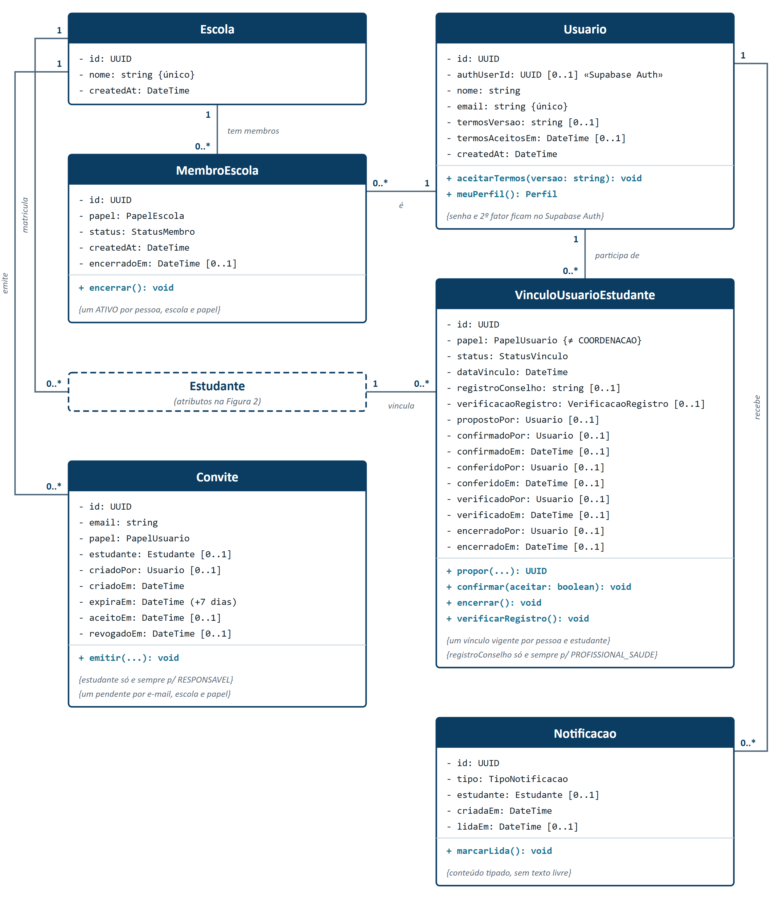
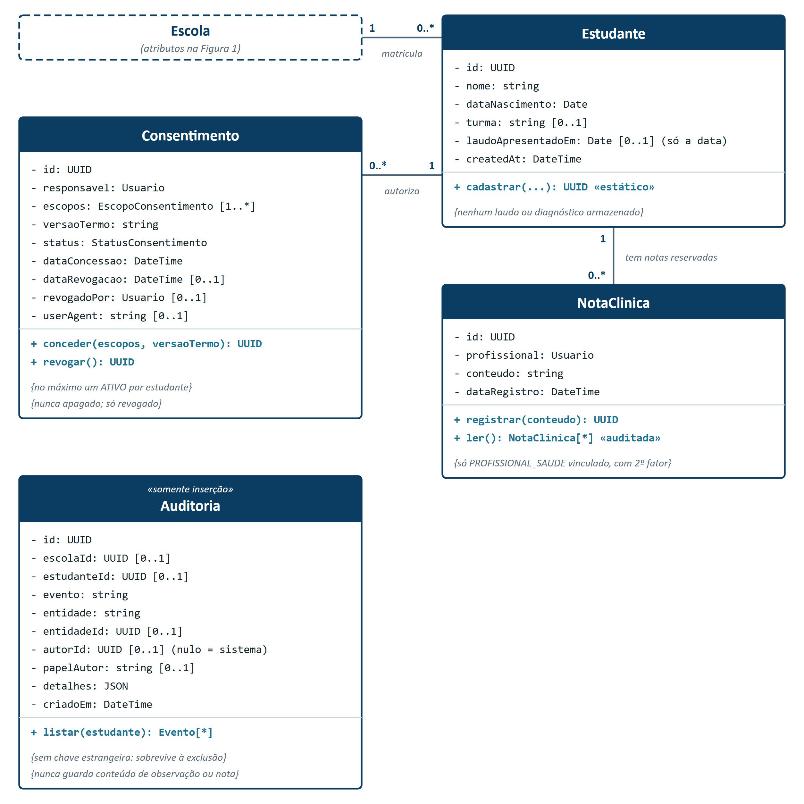
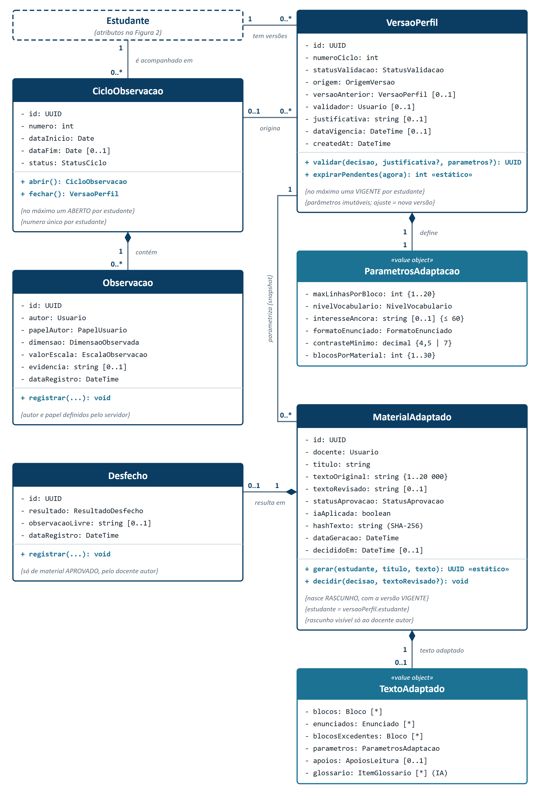
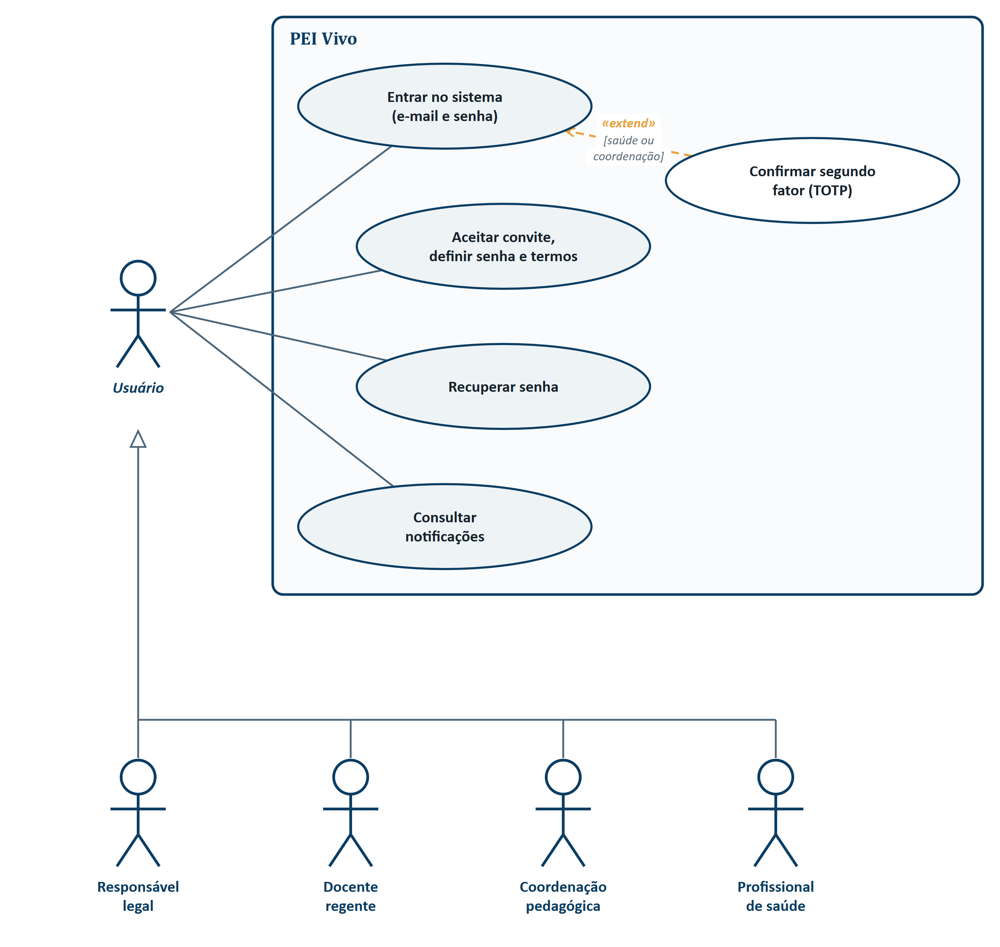
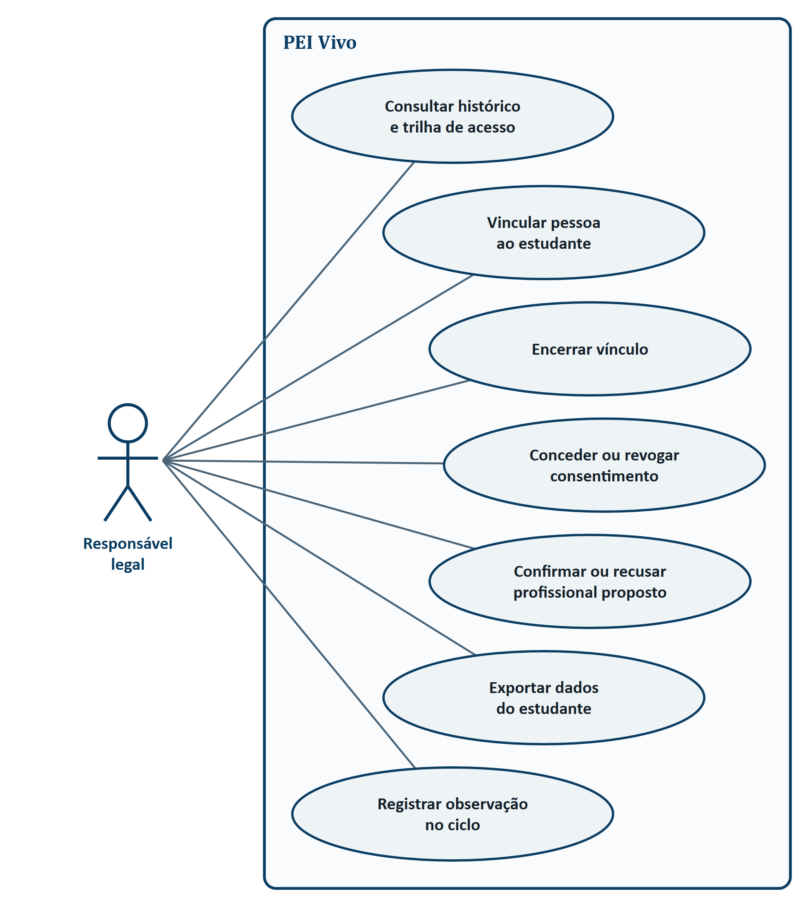
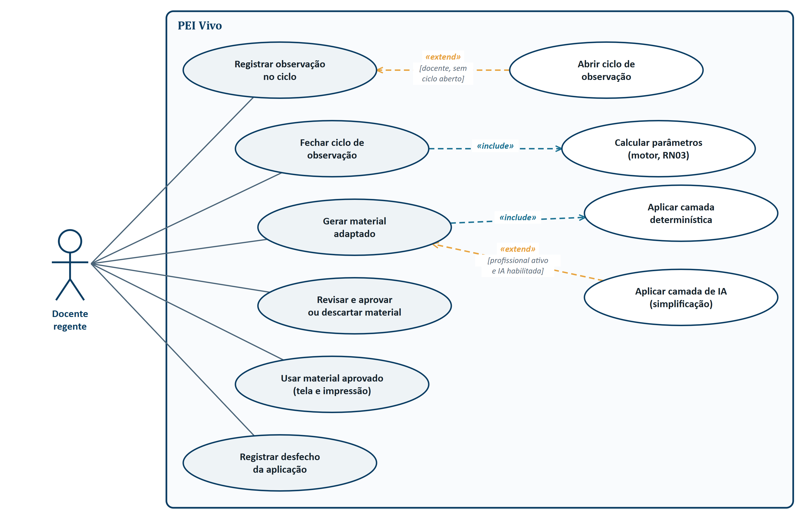
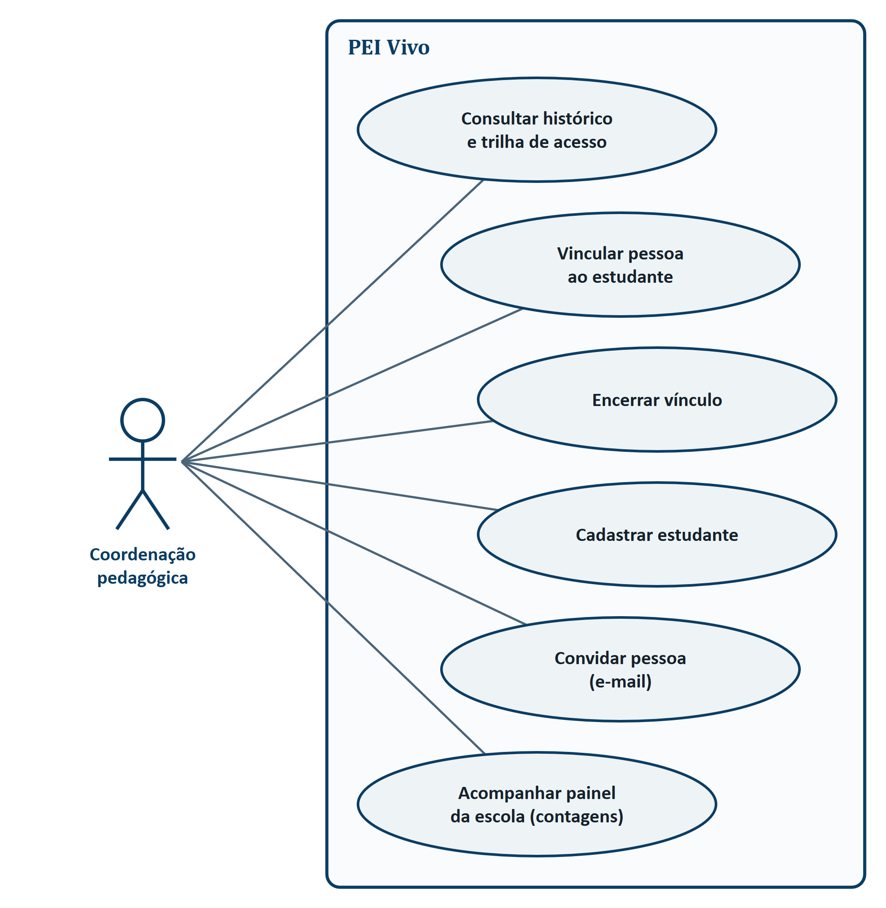
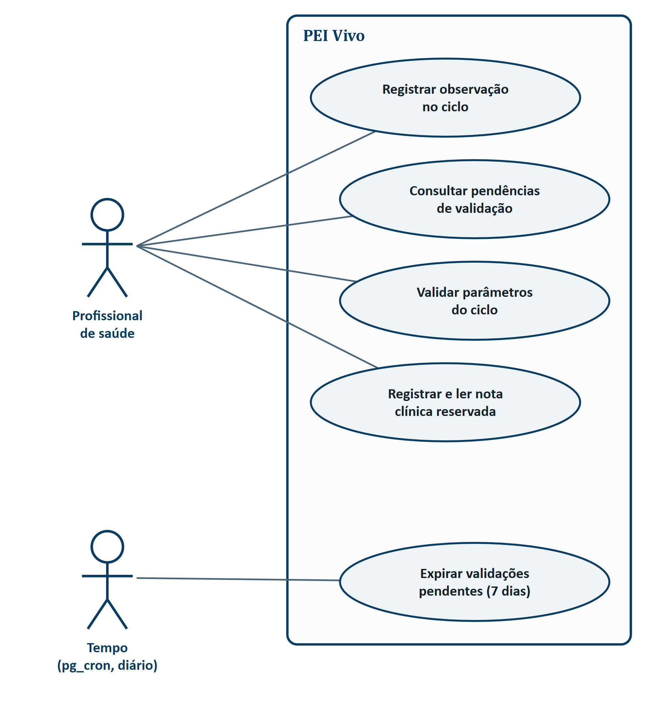

<!--
Versão revisada (26/10/2026) de artigo.md — o original fica preservado.
Gera o .docx com:
  python scripts/artigo/gerar_docx.py docs/tcc/artigo/artigo_revisado.md docs/tcc/artigo/Artigo_PEI_Vivo_v3_revisado.docx
Mudanças: subtítulo; subseções do referencial teórico com 4 parágrafos; seção 3 (Sistemas
semelhantes) no lugar de 2.6/2.7; Metodologia (seção 4) com arquitetura, banco, integrações e
procedimentos de teste levantados na auditoria (AUDITORIA.md); Considerações finais sem
resultados (a seção de Resultados e discussões não faz parte desta versão); declaração de IA
como seção 6. Marcadores [PREENCHER], [CONFERIR], [CONFIRMAR COM O AVALIADOR] e [COMPLETAR]
saem em amarelo: são dados que só a dupla tem ou dúvidas do avaliador.
-->

# PEI VIVO: SISTEMA WEB PARA ADAPTAÇÃO CONTÍNUA DE MATERIAL DIDÁTICO A PARTIR DE OBSERVAÇÃO PEDAGÓGICA VALIDADA POR PROFISSIONAL DE SAÚDE

@autores

## RESUMO

O Plano Educacional Individualizado (PEI) é reconhecido na literatura nacional como instrumento relevante para a inclusão escolar, mas ainda pouco operacionalizado e pouco traduzido em material didático. Este artigo técnico apresenta o PEI Vivo, sistema web que organiza um ciclo quinzenal em que docente, família e profissional de saúde registram observações em seis dimensões, um motor de regras determinísticas converte essas observações em parâmetros de adaptação, o profissional de saúde valida o conjunto de parâmetros e o docente gera, revisa e aprova o material adaptado. A pesquisa é aplicada e segue a Design Science Research. São apresentados a fundamentação teórica, a comparação com sistemas semelhantes, os requisitos, as regras de negócio, a modelagem UML e o método de avaliação. O sistema é construído em TypeScript, com interface React e banco PostgreSQL na plataforma Supabase, organizado em onze migrações com 15 tabelas, e as permissões são aplicadas pelo próprio banco, por Row Level Security e por funções que verificam papel e consentimento. Os resultados da implementação e da avaliação com usuários serão apresentados na etapa seguinte do trabalho. [CONFIRMAR COM O AVALIADOR: se o resumo desta entrega deve antecipar resultados; os números de testes e de tentativas de acesso bloqueadas saíram junto com a seção de resultados.]

**Palavras-chave:** Educação inclusiva; Plano Educacional Individualizado; Adaptação de material didático; Controle de acesso; LGPD.

## ABSTRACT

Brazilian studies recognize the Individualized Education Plan (PEI) as a relevant instrument for school inclusion, yet it is still rarely operationalized or turned into teaching material. This technical paper presents PEI Vivo, a web system that runs a biweekly cycle in which teachers, families and health professionals record observations on six dimensions; a deterministic rule engine converts them into adaptation parameters; a health professional validates the parameter set; and the teacher generates, reviews and approves the adapted material. The research is applied and follows Design Science Research. The paper presents the theoretical background, a comparison with similar systems, requirements, business rules, UML models and evaluation method. The system is built in TypeScript with React and PostgreSQL on Supabase, organized in eleven migrations with 15 tables, and permissions are enforced by the database itself through Row Level Security and functions that check role and consent. Implementation and user evaluation results will be presented in the next stage of the work.

**Keywords:** Inclusive education; Individualized Education Plan; Adaptive learning materials; Access control; Data protection.

# 1. INTRODUÇÃO

O crescimento das matrículas da Educação Especial no Brasil evidencia um avanço expressivo no acesso à escolarização de estudantes com deficiência e transtornos do neurodesenvolvimento: em 2025, essas matrículas alcançaram 2,5 milhões, um aumento de 82% em relação a 2021, com mais de 90% dos estudantes já inseridos em classes comuns do ensino regular, segundo o Censo Escolar do Instituto Nacional de Estudos e Pesquisas Educacionais Anísio Teixeira (Inep, 2026). Esse avanço, contudo, não veio acompanhado de igual fortalecimento da estrutura pedagógica necessária para sustentar a permanência desses estudantes com aprendizagem efetiva: o mesmo levantamento indica que apenas 11,3% das equipes gestoras escolares possuem formação continuada específica em Educação Especial.

Um dos instrumentos usados para responder a essa demanda é o Plano Educacional Individualizado (PEI), que se apoia nas obrigações do art. 28 da Lei Brasileira de Inclusão da Pessoa com Deficiência, Lei nº 13.146, entre elas a adoção de adaptações razoáveis e de medidas individualizadas para o estudante com deficiência (Brasil, 2015). A literatura nacional, entretanto, aponta a baixa operacionalização desse instrumento. Silva e Camargo (2021), em revisão integrativa de 16 artigos, concluíram que a produção acadêmica brasileira não explica de forma clara como o PEI pode ou deve ser elaborado e executado. Pereira e Pereira (2022) observaram que, mesmo onde o plano é elaborado, o entendimento sobre o trabalho colaborativo na sua implementação ainda é deficitário, e Modesto, Araújo e Mendonça (2023) associaram as dificuldades da educação especial ao investimento público insuficiente e à falta de formação continuada de professores.

Especificamente para os casos de dislexia e Transtorno do Déficit de Atenção com Hiperatividade (TDAH), a Lei nº 14.254 (Brasil, 2021) determina o acompanhamento integral do educando, com articulação entre a rede de ensino e a rede de saúde. No levantamento exploratório realizado neste trabalho (seção 4.1), 63,0% dos 27 respondentes descreveram a comunicação atual entre escola, família e saúde como informal e fragmentada, conduzida predominantemente por aplicativos de mensagens, sem histórico recuperável nem continuidade entre ciclos letivos. Por se tratar de amostra de conveniência, esse dado caracteriza o problema no grupo consultado, sem pretensão de generalização.

Mesmo quando o conhecimento sobre o estudante é registrado, sua conversão em material didático acessível exige que o docente reescreva cada texto segundo as necessidades de cada estudante, tarefa que concorre com o tempo de planejamento de uma turma numerosa e com múltiplos perfis de necessidade. A adaptação, nesse contexto, frequentemente não ocorre, não por omissão docente, mas pela ausência de um mecanismo que a torne operacionalmente viável em escala. [PREENCHER: se a dupla cronometrar docentes adaptando o mesmo texto, inserir aqui o tempo medido e o método; caso contrário, manter o parágrafo sem número.]

Diante do exposto, formula-se o seguinte problema de pesquisa: como um sistema de informação pode integrar o registro periódico de observações pedagógicas, a validação técnica de profissional de saúde e a geração de material didático adaptado, de modo a transformar o Plano Educacional Individualizado em instrumento continuamente atualizado a partir da evolução do estudante, protegendo dados pessoais sensíveis de crianças?

O objetivo geral deste trabalho é desenvolver e avaliar o PEI Vivo, aplicação web que integra observações pedagógicas periódicas sobre o estudante a um motor de adaptação de materiais didáticos, com validação do conjunto de parâmetros por profissional de saúde a cada ciclo, quando houver profissional vinculado, ou em modo exclusivamente pedagógico, quando não houver. Os objetivos específicos são:

a) modelar o ciclo observar, validar, adaptar e retroalimentar por meio de requisitos, regras de negócio e diagramas UML;

b) implementar um controle de acesso aplicado no banco de dados que negue toda tentativa de acesso indevido catalogada, independentemente da interface;

c) implementar um motor de adaptação determinístico, auditável e testável de forma isolada, que aplique a regra de assimetria conservadora (RN03) a todos os parâmetros;

d) desenvolver um protótipo web acessível, com telas para os quatro perfis de usuário, aderente às WCAG 2.2 nível AA;

e) avaliar a usabilidade do protótipo com docentes, responsáveis e profissionais de saúde, pela escala SUS, com meta igual ou superior a 68 pontos.

## 1.1 Justificativa

A relevância do tema sustenta-se em três dimensões complementares. No plano legal e social, o problema investigado corresponde a uma obrigação normativa vigente e ainda sem instrumento operacional, conforme a Lei nº 14.254/2021. No plano tecnológico, as soluções de mercado consultadas (seção 3) já combinam gestão do plano e adaptação de conteúdo por IA, mas nenhuma integra ao ciclo a validação por profissional de saúde nem oferece uma adaptação que funcione sem IA. No plano prático, um sistema como o PEI Vivo pode reduzir o esforço da adaptação docente e preservar o conhecimento sobre o estudante entre ciclos letivos e trocas de professor, uma vez que o perfil pertence ao estudante e não ao docente.

Há ainda uma justificativa de proteção de dados. Informações sobre a saúde de crianças são dados pessoais sensíveis (Brasil, 2018, art. 11) e exigem consentimento específico de pelo menos um dos pais ou responsável (Brasil, 2018, art. 14). Um sistema que circula esse tipo de informação entre escola e saúde precisa demonstrar, e não apenas declarar, que cada pessoa acessa somente o necessário ao seu papel.

O trabalho relaciona-se aos Objetivos de Desenvolvimento Sustentável 4 (Educação de Qualidade), em especial à meta 4.5, que trata do acesso igualitário à educação para pessoas com deficiência, e 3 (Saúde e Bem-Estar), ao formalizar a participação da rede de saúde no acompanhamento escolar (Organização das Nações Unidas, 2015). O sistema não mede bem-estar diretamente; a contribuição para o ODS 3 é de articulação entre serviços.

O escopo delimita-se ao ensino fundamental, com cenário de demonstração de um estudante fictício de nove anos, a escolas que adotem o sistema por iniciativa da coordenação pedagógica e a estudantes cujas famílias consintam com o uso. Transferência entre escolas e uso pelo próprio estudante ficam fora do escopo.

Além desta introdução, o artigo está organizado em mais cinco seções. A seção 2 apresenta a fundamentação teórica: o PEI na educação inclusiva, as implicações do TEA, do TDAH e da dislexia para a leitura, as estratégias de adaptação de texto e acessibilidade, a proteção de dados de crianças com o controle de acesso na camada de dados e as tecnologias adotadas. A seção 3 compara o PEI Vivo com sistemas semelhantes de terceiros. A seção 4 descreve a metodologia: a classificação da pesquisa, o método de desenvolvimento com requisitos, regras de negócio, diagramas UML e cronograma, a arquitetura, o banco de dados e as integrações, e os procedimentos de teste e de avaliação. A seção 5 traz as considerações finais e a seção 6, a declaração de uso de inteligência artificial generativa. [CONFIRMAR COM O AVALIADOR: quais afirmações da introdução ele considerou sem referência. Nesta revisão, as atribuições aos autores citados foram conferidas com os textos de origem e corrigidas, e a base legal do PEI passou a citar o artigo da lei.]

# 2. FUNDAMENTAÇÃO TEÓRICA

## 2.1 Educação inclusiva e o Plano Educacional Individualizado

Silva e Camargo (2021) definem o Plano Educacional Individualizado como uma metodologia de trabalho colaborativa, centrada no estudante com deficiência e elaborada a partir de sua série, idade, grau de desenvolvimento, habilidades e conhecimentos prévios, para estabelecer objetivos de aprendizagem de curto, médio e longo prazos e avaliar o progresso do estudante. A Lei Brasileira de Inclusão não nomeia o PEI, mas incumbe ao poder público assegurar adaptações razoáveis que garantam o pleno acesso ao currículo (art. 28, III), a adoção de medidas individualizadas e coletivas que maximizem o desenvolvimento acadêmico e social dos estudantes com deficiência (art. 28, V) e a elaboração de plano de atendimento educacional especializado (art. 28, VII) (Brasil, 2015). Por isso, Silva e Camargo (2021) defendem que o PEI esteja explícito na legislação educacional brasileira.

Para educandos com dislexia, TDAH ou outro transtorno de aprendizagem, a Lei nº 14.254/2021 determina que o poder público mantenha programa de acompanhamento integral, que compreende a identificação precoce, o encaminhamento para diagnóstico, o apoio educacional na rede de ensino e o apoio terapêutico especializado na rede de saúde (art. 1º, parágrafo único). A mesma lei estabelece que as necessidades específicas do educando serão atendidas pelos profissionais da rede de ensino em parceria com profissionais da rede de saúde (art. 4º) e que os sistemas de ensino devem garantir aos professores acesso à informação e formação continuada (art. 5º) (Brasil, 2021). É nessa parceria entre escola e saúde que o PEI Vivo apoia a validação dos parâmetros pelo profissional de saúde.

Na produção acadêmica, Silva e Camargo (2021) analisaram 16 artigos nacionais sobre o PEI e concluíram que essa produção não o operacionaliza, isto é, não explica de forma clara, sintética e objetiva como o plano pode ou deve ser elaborado e executado; apenas um dos artigos demonstrou contribuições do uso do PEI para o estudante, e as condições estudadas foram o TEA, a deficiência intelectual e as altas habilidades. Pereira e Pereira (2022), em estudo documental sobre estudantes com deficiência intelectual em escola municipal de Campo Grande (MS), verificaram que o PEI era elaborado e aplicado, mas que o entendimento sobre o trabalho colaborativo na sua implementação ainda era deficitário, de modo que as práticas permaneciam distantes do que estabelecem os documentos da Educação Especial. Fontana e Cruz (2022), em revisão de dez dissertações e duas teses, identificaram o PEI como ferramenta pedagógica importante para organizar o ensino e para a aprendizagem e o desenvolvimento de estudantes com necessidades educacionais especiais.

Battistello, Lisboa e Martins (2024), em revisão bibliográfica, tratam o PEI como instrumento norteador para a inclusão de estudantes autistas no ensino regular, inclusão que ainda enfrenta muitos obstáculos. Modesto, Araújo e Mendonça (2023), ao analisar a implementação da educação especial na rede estadual de Sergipe, identificaram avanços acompanhados de investimento público insuficiente e de falta de formação continuada de professores. Em conjunto, esses estudos indicam que o PEI é reconhecido como instrumento relevante, mas carece de operacionalização e de trabalho colaborativo efetivo. Nenhum deles trata de sistemas de informação: a hipótese de que um sistema que mantenha o plano atualizado ciclo a ciclo, com escola, família e saúde, possa reduzir essa lacuna é deste trabalho. [CONFERIR: Battistello, Lisboa e Martins (2024), Modesto, Araújo e Mendonça (2023) e Fontana e Cruz (2022) foram conferidos pelo resumo; Silva e Camargo (2021) e Pereira e Pereira (2022), pelo texto integral. Ler os três primeiros antes da entrega.]

## 2.2 TEA, TDAH e dislexia: implicações para a leitura

O Transtorno do Espectro Autista (TEA), o TDAH e a dislexia são transtornos do neurodesenvolvimento com manifestações distintas, mas com efeitos convergentes sobre a leitura de materiais escolares (American Psychiatric Association, 2023). No TDAH, a dificuldade de sustentar a atenção torna textos longos e enunciados com várias instruções encadeadas mais custosos. Na dislexia, a decodificação de palavras é mais lenta e menos precisa, o que aumenta o peso de vocabulário pouco frequente e de blocos densos de texto. No TEA, a sensibilidade sensorial e a preferência por instruções explícitas podem tornar relevantes o contraste visual, a previsibilidade da estrutura e o uso de interesses específicos como ponto de entrada.

A Lei nº 14.254/2021 descreve esses educandos pelo efeito observável na aprendizagem, ao tratar de alterações no desenvolvimento da leitura e da escrita, ou de instabilidade na atenção, que repercutam na aprendizagem, e lhes assegura acompanhamento específico pelos educadores da escola, com apoio e orientação da área de saúde (Brasil, 2021, art. 3º). A formulação legal, centrada no que se observa na escola, e não no rótulo diagnóstico, é coerente com a abordagem adotada neste trabalho.

Para este trabalho, importa menos a categoria diagnóstica e mais o comportamento observável em sala, que varia entre estudantes com o mesmo diagnóstico e no mesmo estudante ao longo do tempo. Por isso o sistema registra seis dimensões observáveis (atenção sustentada, compreensão de enunciados, autonomia com palavras, interesse manifesto, sensibilidade visual e cansaço na tarefa) em escala de três pontos (reduzida, estável, ampliada) e, por decisão de projeto, não armazena laudo nem diagnóstico (seção 4.2.3).

Cada dimensão observada corresponde a um parâmetro de apresentação do material: a atenção sustentada define o número máximo de linhas por bloco; a compreensão de enunciados, o formato do enunciado (etapa única ou múltiplas etapas); a autonomia com palavras, o nível de vocabulário; o interesse manifesto, o tema usado como âncora; a sensibilidade visual, o contraste mínimo; e o cansaço na tarefa, o número de blocos por material. Essa correspondência, implementada no motor de adaptação, é uma hipótese de projeto derivada das implicações descritas acima, e não uma relação estabelecida pela literatura consultada; por isso cada parâmetro é explícito, limitado a uma faixa válida e ajustável pelo profissional de saúde a cada ciclo.

## 2.3 Estratégias de adaptação de texto e acessibilidade

O Desenho Universal para a Aprendizagem (DUA) propõe oferecer múltiplos meios de representação do conteúdo, reduzindo barreiras sem alterar o objetivo de aprendizagem (CAST, 2018). As estratégias aplicadas pelo motor do PEI Vivo seguem essa orientação: o texto é o mesmo da turma, mas apresentado em blocos de poucas linhas, com enunciados compostos divididos em etapas, contraste mínimo configurável, limite de blocos por material e apoios de leitura (pictograma por etapa, glossário de palavras e leitura em voz alta pelo navegador).

As diretrizes do DUA organizam-se em três princípios: oferecer múltiplos meios de engajamento, de representação e de ação e expressão (CAST, 2018). O PEI Vivo atua sobretudo no segundo, pois altera a forma de apresentar o texto, e não a tarefa proposta nem a forma de resposta do estudante. As WCAG 2.2, por sua vez, organizam os critérios de acessibilidade em quatro princípios, segundo os quais o conteúdo deve ser perceptível, operável, compreensível e robusto (World Wide Web Consortium, 2024). No sistema, esses critérios valem para dois públicos: as pessoas que usam as telas (docentes, famílias e profissionais) e o estudante que recebe o material.

Os limiares de contraste adotados (4,5:1 e 7:1) correspondem aos critérios de sucesso 1.4.3 (nível AA) e 1.4.6 (nível AAA) das WCAG 2.2 (World Wide Web Consortium, 2024), também incorporadas à ABNT NBR 17225 (Associação Brasileira de Normas Técnicas, 2025). A preferência por fontes sem serifa e de formas bem diferenciadas encontra apoio em Rello e Baeza-Yates (2013), que mediram desempenho de leitura de pessoas com dislexia em diferentes fontes. Os demais limiares (número de linhas por bloco, níveis de vocabulário e quantidade de blocos por material) não têm valor de referência único na literatura consultada: são hipóteses de projeto, explícitas e ajustáveis pelo profissional de saúde, a serem calibradas no uso.

Duas escolhas complementam essas estratégias. A primeira é que todo material gerado passa por revisão e aprovação explícita do docente antes de chegar ao estudante (RN04), de modo que a adaptação automática é sempre uma proposta, e não uma publicação. A segunda é que o material existe em versão web acessível e em versão para impressão (RF12), o que atende escolas com pouca disponibilidade de equipamentos, preocupação mais citada no levantamento exploratório (seção 4.1), e preserva o princípio de múltiplos meios de representação do DUA (CAST, 2018).

## 2.4 Proteção de dados e controle de acesso na camada de dados

O tratamento de dados de crianças e adolescentes com deficiência envolve dado pessoal sensível (Brasil, 2018, art. 11) e exige consentimento específico e em destaque dado por pelo menos um dos pais ou pelo responsável legal (Brasil, 2018, art. 14, § 1º). A lei também impõe os princípios da finalidade e da necessidade (Brasil, 2018, art. 6º, I e III), segundo os quais cada pessoa deve acessar apenas o mínimo necessário à sua função.

A LGPD define como dado pessoal sensível, entre outros, o dado referente à saúde, quando vinculado a uma pessoa natural (Brasil, 2018, art. 5º, II). Além da finalidade e da necessidade, o art. 6º inclui os princípios da segurança, que exige medidas técnicas e administrativas aptas a proteger os dados de acessos não autorizados (inciso VII), da prevenção (inciso VIII) e da responsabilização e prestação de contas, que exige demonstrar a adoção de medidas eficazes (inciso X). No caso de crianças, as informações sobre o tratamento devem ser fornecidas de maneira simples, clara e acessível aos pais ou ao responsável (Brasil, 2018, art. 14, § 6º). No PEI Vivo, esses princípios se traduzem em três escolhas verificáveis: permissões aplicadas pelo banco, trilha de auditoria que não admite alteração e uma tela em que o responsável vê quem tem acesso aos dados do estudante.

Para atender a esses princípios de forma verificável, adotou-se o sistema gerenciador de banco de dados relacional PostgreSQL, que oferece Row Level Security (RLS): políticas que restringem, na própria camada do banco, quais linhas de uma tabela cada usuário autenticado pode ler ou modificar (PostgreSQL Global Development Group, 2025). Com isso, a restrição de acesso de um docente às notas reservadas do profissional de saúde, por exemplo, é aplicada pelo banco independentemente da interface, o que impede que a informação seja obtida por chamada direta à interface de programação de aplicações (API).

A LGPD também assegura ao titular, ou ao responsável no caso de crianças, os direitos de acesso aos dados, de eliminação dos dados tratados com consentimento e de revogação do consentimento (Brasil, 2018, art. 18, II, VI e IX), e determina que controlador e operador mantenham registro das operações de tratamento que realizarem (Brasil, 2018, art. 37). No PEI Vivo, esses dispositivos orientam a revogação do consentimento com bloqueio imediato das gerações (RN08), a exportação dos dados do estudante a pedido do responsável (RF15) e a tabela de auditoria, escrita apenas por gatilhos do banco, que registra concessões, revogações, fechamentos de ciclo, validações e cada leitura de nota clínica.

## 2.5 Tecnologias para sistemas web

A construção de sistemas de informação demanda escolhas arquiteturais que equilibrem manutenibilidade, desempenho, segurança e confiabilidade, características de qualidade definidas na norma ISO/IEC 25010 (International Organization for Standardization, 2023). Neste trabalho, adotou-se a linguagem TypeScript em todas as camadas, por sua tipagem estática, que permite detectar em tempo de compilação uma configuração inválida de parâmetros de adaptação. A interface foi construída com a biblioteca React e a ferramenta de build Vite. A camada de servidor usa a plataforma Supabase, que reúne PostgreSQL, autenticação com segundo fator (TOTP) e funções serverless (Edge Functions) executadas fora do navegador (Supabase, 2025).

Na plataforma Supabase, o navegador acessa o banco diretamente por uma API gerada a partir do esquema; por isso, a documentação da plataforma orienta a habilitar o RLS em todas as tabelas de esquemas expostos (Supabase, 2025). Essa característica explica a divisão adotada: leituras e escritas simples passam pelas políticas do banco, enquanto as operações que precisam de credenciais de serviço, como gerar material e fechar um ciclo, ficam em Edge Functions, que conferem de novo, no banco, o papel e o consentimento de quem as chama.

A separação entre uma camada determinística, implementada como código-fonte auditável, e uma camada opcional assistida por modelo de linguagem decorre de exigência de confiabilidade: regras que alteram o material recebido por uma criança devem ser verificáveis e reproduzíveis, condição que código determinístico satisfaz e que a saída de um modelo de linguagem não garante.

Para que a mesma regra valha em todas as camadas, o código foi organizado em pacotes independentes: o motor de adaptação, com funções puras sem acesso a banco ou rede; os casos de uso das Edge Functions, que recebem o banco e os serviços externos como dependências injetadas e, por isso, são testáveis sem infraestrutura; e os contratos de entrada e saída, escritos uma única vez com a biblioteca Zod e usados tanto na validação dos formulários quanto na validação das requisições no servidor. Essa separação permite verificar cada regra isoladamente antes de integrá-la ao banco e à interface.

# 3. SISTEMAS SEMELHANTES

Esta seção compara o PEI Vivo com sistemas de terceiros que tratam do mesmo problema, o plano individualizado e a adaptação de material para estudantes com necessidades específicas. Foram incluídos apenas produtos com documentação pública verificável, consultada pelos autores em 13/10/2026 e conferida novamente em 26/10/2026; nenhum deles é de autoria dos autores deste trabalho. As características do PEI Vivo foram extraídas do código-fonte do repositório (migrações do banco, motor de adaptação e Edge Functions), e não da especificação. Como a comparação depende do que cada fornecedor publica, uma característica não documentada aparece como tal, e não como ausente.

A plataforma brasileira Prova Adaptada, oferecida também sob o nome IncluiAI (Prova Adaptada, 2026), utiliza inteligência artificial para gerar o PEI e adaptar atividades e provas elaboradas pelo docente, em função das necessidades de alunos atípicos. A página pública não descreve um perfil individual atualizado ciclo a ciclo, validação por profissional de saúde, modo de funcionamento sem IA nem o tratamento do consentimento, limitando-se a indicar uma política de privacidade. A plataforma Vínculoo (Vínculoo, 2026) organiza o PEI e o Plano de Atendimento Educacional Especializado em um padrão único, prevê devolutiva à família e participação do responsável nas revisões do plano, e oferece um assistente de IA que lê laudos, relatórios e observações, rascunha as metas e adapta a atividade da turma para cada estudante, com revisão e ajuste final do professor. Menciona terapias externas e equipe multidisciplinar, sem descrever uma validação formal por profissional de saúde.

No cenário internacional, as plataformas estadunidenses Frontline Education (Frontline Education, 2026) e Goalbook Toolkit (Goalbook, 2026) apoiam o Individualized Education Program (IEP), equivalente ao PEI. A primeira concentra-se na conformidade com a regulação, na escrita colaborativa do plano com acesso por papel, no acompanhamento do progresso e em rotinas administrativas; a segunda, na redação de metas e de níveis atuais de desempenho e em estratégias de instrução especialmente planejada, com um recurso opcional de IA para recomendações. Nenhuma das duas páginas descreve a geração do material didático usado em sala. Já o Leitor Imersivo da Microsoft (Microsoft, 2024) atua no outro extremo: é uma ferramenta de leitura, integrada a produtos como Word e OneNote e disponível como serviço para aplicações web, que isola o texto, lê em voz alta, separa sílabas, destaca classes gramaticais, traduz e exibe imagens para palavras comuns, voltada a leitores iniciantes e a pessoas com dislexia. Ele apoia a leitura de qualquer texto, mas não mantém plano individual, perfil do estudante nem fluxo entre escola, família e saúde.

O PEI Vivo ocupa o espaço entre essas duas famílias de solução. Do lado do plano, mantém um perfil por estudante com seis parâmetros, recalculado a cada ciclo quinzenal pela regra de assimetria conservadora (RN03) e validado pelo profissional de saúde vinculado (RN07); do lado do material, gera o texto adaptado por regras determinísticas, com apoios de leitura semelhantes aos do Leitor Imersivo (blocos curtos, etapas, glossário, pictogramas e leitura em voz alta), mas parametrizados pelo perfil e sempre aprovados pelo docente (RN04). A camada de IA existe no código, porém está desligada por padrão e, quando ligada, só recebe o texto e os parâmetros, nunca dados do estudante. O Quadro 1 resume a comparação segundo sete critérios derivados do problema de pesquisa.

Quadro 1 – Comparação entre o PEI Vivo e sistemas semelhantes

| Critério | Prova Adaptada (IncluiAI) | Vínculoo | Frontline / Goalbook | Leitor Imersivo | PEI Vivo |
|---|---|---|---|---|---|
| Perfil individual atualizado por ciclo | Não documentado | Não documentado (revisões do PEI) | Metas do IEP | Não | Sim (6 parâmetros, ciclo quinzenal) |
| Participação formal da saúde | Não documentada | Não documentada (equipe multidisciplinar) | Não documentada | Não | Validação do conjunto de parâmetros |
| Geração de material adaptado | Sim (IA) | Sim (IA, a partir de documentos e laudos) | Não documentada | Não (apoia a leitura de texto pronto) | Sim (regras determinísticas, sem laudo) |
| Apoios de leitura no material | Não documentado | Não documentado | Não se aplica | Sim (voz, sílabas, imagens, tradução) | Sim (blocos, etapas, glossário, pictograma, voz) |
| Funciona sem IA | Não documentado | Não documentado | Não se aplica | Sim | Sim (IA desligada por padrão) |
| Consentimento granular e revogável | Não documentado | Não documentado | Não documentado | Não se aplica | Sim (4 escopos, revogação imediata) |
| Permissões aplicadas no banco e auditadas | Não documentado | Não documentado | Acesso por papel (camada não documentada) | Não se aplica | Sim (RLS em 15 tabelas e auditoria) |

Fonte: Autoria própria (2026), com base na documentação pública das soluções e no código-fonte do PEI Vivo.

No campo acadêmico, Rello e Baeza-Yates (2013) avaliaram experimentalmente o efeito de fontes tipográficas na leitura de pessoas com dislexia, o que sustenta parte das decisões de apresentação do material, mas não propõem um sistema de acompanhamento. [PREENCHER: incluir 1 ou 2 trabalhos acadêmicos sobre sistemas de apoio ao PEI/IEP ou simplificação de texto, com a busca descrita em 4.4.]

# 4. METODOLOGIA

## 4.1 Classificação da pesquisa

Quanto à natureza, esta pesquisa classifica-se como aplicada, por ter como finalidade a geração de conhecimento dirigido à solução de um problema específico (Prodanov; Freitas, 2013). Quanto aos objetivos, é exploratória e descritiva. Quanto aos procedimentos, segue a Design Science Research (Hevner et al., 2004; Dresch; Lacerda; Antunes Júnior, 2015), abordagem que orienta a construção de um artefato para resolver um problema relevante e a sua avaliação com critérios definidos previamente. O artefato é o PEI Vivo; a avaliação combina verificação técnica automatizada e avaliação de usabilidade com usuários (seção 4.4). Não houve experimento controlado. [CONFIRMAR COM O AVALIADOR: a versão avaliada classificava os procedimentos como pesquisa bibliográfica e experimental. Essa classificação foi trocada na versão 2 porque não houve manipulação de variáveis com grupo de controle, condição da pesquisa experimental. Confirmar se o avaliador aceita a troca ou prefere a redação original.]

Na etapa de conscientização do problema, aplicou-se em setembro de 2026 um questionário eletrônico (Google Forms) a 27 pessoas envolvidas no acompanhamento de estudantes neurodivergentes: 12 responsáveis, 10 profissionais de apoio escolar e 5 docentes. Nenhum profissional de saúde respondeu, o que constitui limitação relevante, já que esse é o perfil que valida os parâmetros no sistema. O questionário abordou a comunicação atual entre escola, família e saúde, a avaliação da proposta em escala de 1 a 5 e as preocupações com a plataforma.

Para 63,0% dos respondentes a comunicação atual é informal e fragmentada, enquanto 18,5% discordaram dessa afirmação. A proposta recebeu nota 4 ou 5 de 81,5% (22 de 27). As preocupações mais citadas foram a dependência de tecnologia em escolas com poucos recursos (59,3%), a privacidade dos dados da criança (51,9%) e a confiabilidade do material gerado por IA (37,0%); 11,1% não indicaram preocupação. [CONFERIR: recontar cada percentual na planilha original com CONT.SE antes da entrega.] Como a pergunta de avaliação foi feita logo após a apresentação da proposta pelos autores, o resultado indica aceitação inicial do conceito, e não validação do produto. As regras de privacidade (RN01, RN02 e RN08) já constavam da especificação antes da coleta; as respostas as confirmaram, e a preocupação com dependência de tecnologia orientou a decisão de manter uma camada que funciona sem IA e a versão impressa do material.

O formulário coletou nome e e-mail dos participantes, dado que não era necessário à análise, e não apresentou Termo de Consentimento Livre e Esclarecido (TCLE). Para a análise, as respostas foram codificadas de R01 a R27 e os identificadores foram descartados. [CONFERIR: executar a anonimização antes de citar esta frase; declarar ou excluir a resposta com conflito de interesse e recalcular.] A pesquisa de opinião com participantes não identificados está dispensada de registro no sistema CEP/Conep (Brasil, 2016, art. 1º, parágrafo único, I) [CONFERIR: inciso com a orientadora]; a avaliação de usabilidade (seção 4.4) usa formulário anônimo com TCLE na primeira página.

## 4.2 Método de desenvolvimento

O desenvolvimento foi iterativo, organizado em marcos: especificação (requisitos, regras de negócio e modelagem UML), banco de dados com políticas de acesso, motor de adaptação, protótipo de interface e, após uma auditoria interna em 07/10/2026 que encontrou 25 de 31 tentativas de acesso indevido aceitas pelas políticas da época, uma reformulação em seis marcos (R0 a R5): banco que nega, autenticação real, regras no servidor, experiência de uso e verificação final. Cada decisão de projeto foi registrada com código próprio (D-01 a D-46) e justificativa, e o trabalho foi acompanhado em quadro Kanban no GitHub. O repositório está disponível em https://github.com/geandreac/tcc-peivivo.

### 4.2.1 Requisitos funcionais

Foram levantados 15 requisitos funcionais, que cobrem o ciclo completo do sistema, da obtenção do consentimento à exportação dos dados, conforme o Quadro 2. A coluna Situação indica o estado em 26/10/2026.

[CONFIRMAR COM O AVALIADOR: na parte de requisitos funcionais, o avaliador mencionou "Payday 2006" (transcrição). O termo não aparece no artigo, nas versões anteriores, no modelo da FAMETRO nem no parecer da orientadora. Pode ser um autor ou uma obra a citar como base para requisitos, ou um erro da transcrição. Confirmar o nome exato e a função, e acrescentar a referência só depois de conferida.]

Quadro 2 – Requisitos funcionais

| Código | Descrição | Situação |
|---|---|---|
| RF01 | Cadastrar estudante e propor vínculos de docente e profissional | Implementado |
| RF02 | Registrar concessão ou revogação de consentimento, por escopo, com trilha de auditoria | Implementado |
| RF03 | Registrar observação estruturada do docente a cada ciclo quinzenal | Implementado |
| RF04 | Registrar observações complementares do responsável e do profissional de saúde | Implementado |
| RF05 | Converter observações em parâmetros de adaptação por regras determinísticas | Implementado |
| RF06 | Submeter os parâmetros do ciclo à validação do profissional de saúde | Implementado |
| RF07 | Processar aprovação, pedido de revisão, ajuste ou expiração automática da validação (7 dias) | Implementado |
| RF08 | Gerar material adaptado a partir do texto inserido e dos parâmetros vigentes | Implementado |
| RF09 | Aplicar a camada determinística (segmentação, etapas, contraste, apoios de leitura) | Implementado |
| RF10 | Aplicar a camada assistida por IA (simplificação lexical), quando habilitada | Desligado (D-39) |
| RF11 | Permitir revisão, edição e aprovação humana do material antes da publicação | Implementado |
| RF12 | Exibir o material em versão web acessível e em versão para impressão | Implementado |
| RF13 | Registrar o desfecho da aplicação do material em sala | Implementado |
| RF14 | Controlar acesso por papel e por informação | Implementado no banco |
| RF15 | Exportar ou excluir os dados do estudante a pedido do responsável | Exportar implementado; excluir pendente |

Fonte: Autoria própria (2026).

### 4.2.2 Requisitos não funcionais

Os 10 requisitos não funcionais, listados no Quadro 3, fixam as qualidades que todas as funcionalidades devem respeitar e se alinham às características da ISO/IEC 25010. O RNF05 foi revisto durante o desenvolvimento: guardar materiais no navegador para leitura sem conexão exporia dados de criança em aparelhos compartilhados, e por isso nenhum dado de estudante é armazenado no dispositivo (D-29).

Quadro 3 – Requisitos não funcionais

| Código | Categoria | Descrição |
|---|---|---|
| RNF01 | Usabilidade | Pontuação na escala SUS igual ou superior a 68 |
| RNF02 | Desempenho | Geração de material adaptado em menos de 60 segundos |
| RNF03 | Acessibilidade | Conformidade com WCAG 2.2 nível AA e ABNT NBR 17225 |
| RNF04 | Segurança | Permissões no banco (RLS), autenticação com segundo fator para saúde e coordenação, TLS em trânsito |
| RNF05 | Privacidade | Nenhum dado de estudante armazenado no navegador (revisto; antes: cache offline) |
| RNF06 | Portabilidade | Aplicação web responsiva, instalável pelo navegador em Android, iOS e desktop |
| RNF07 | Manutenibilidade | Cobertura de testes automatizados igual ou superior a 70% no motor e nas funções |
| RNF08 | Confiabilidade | Camada determinística operante sem dependência de serviços externos |
| RNF09 | Conformidade legal | Aderência à LGPD: minimização de dados e consentimento granular |
| RNF10 | Escalabilidade | Arquitetura serverless capaz de absorver picos de uso concentrado |

Fonte: Autoria própria (2026).

### 4.2.3 Regras de negócio

As regras de negócio (Quadro 4) independem da tecnologia adotada. A RN02 é uma decisão de projeto, e não uma limitação técnica: a informação diagnóstica não altera a conduta pedagógica do docente e amplia o risco de rotulação, razão pela qual o sistema não armazena laudo nem diagnóstico, apenas a data em que um laudo foi apresentado à escola. A RN03 impõe assimetria deliberada, de modo que eventual erro do sistema recaia sempre sobre o lado mais acessível do material; trata-se de princípio de precaução, cuja adequação pedagógica deve ser acompanhada pelos desfechos registrados (RF13).

Quadro 4 – Regras de negócio

| Código | Regra |
|---|---|
| RN01 | Sem consentimento ativo do responsável legal, nenhuma escrita nem geração ocorre para o estudante; a leitura fica restrita ao responsável e à coordenação |
| RN02 | O docente nunca lê nota clínica, apenas observações e parâmetros; o sistema não armazena laudo nem diagnóstico |
| RN03 | Elevar um parâmetro exige dois ciclos consecutivos de observação "ampliada"; reduzi-lo é imediato |
| RN04 | Nenhum material chega ao estudante sem aprovação explícita do docente |
| RN05 | Sem validação do profissional em 7 dias, a proposta expira e permanece vigente a última versão aprovada; há no máximo uma versão vigente por estudante |
| RN06 | Sem profissional de saúde vinculado, apenas a camada determinística opera (sem IA) |
| RN07 | A validação clínica incide sobre o conjunto de parâmetros do ciclo, nunca sobre material individual |
| RN08 | O responsável pode revogar o consentimento a qualquer momento, com bloqueio imediato de novas gerações |

Fonte: Autoria própria (2026).

### 4.2.4 Diagrama de classes

O diagrama de classes define o modelo de dados do sistema e foi gerado a partir das migrações do banco (0001 a 0008; as migrações 0009 a 0011 acrescentam funções e restrições, sem tabelas novas), de modo que cada classe persistente corresponde a uma tabela. São 15 classes persistentes e 2 objetos de valor (ParametrosAdaptacao, com os seis parâmetros, e TextoAdaptado). Para que continue legível no papel, o diagrama foi dividido em três figuras por domínio: escola, pessoas e vínculos (Figura 1); estudante, consentimento, nota clínica e auditoria (Figura 2); e ciclo de observação, versão do perfil e material (Figura 3). Uma classe desenhada com borda tracejada é detalhada em outra figura e aparece apenas para mostrar a associação. Entre chaves estão as restrições garantidas pelo banco, como uma versão vigente por estudante, um consentimento ativo e parâmetros imutáveis. A senha e o segundo fator não aparecem porque são mantidos pelo serviço de autenticação, e não pelo esquema da aplicação. A versão integral, em uma única imagem, está no repositório (docs/tcc/class_diagram.svg).

{pagina}

Fonte: Autoria própria (2026).



Fonte: Autoria própria (2026).

{pagina}

Fonte: Autoria própria (2026).

Os atributos de status e de tipo usam os 17 tipos enumerados do PostgreSQL listados no Quadro 5, e cada operação das classes é implementada por uma função do banco ou por uma Edge Function, conforme o Quadro 6.

Quadro 5 – Tipos enumerados do modelo de dados

| Tipo | Valores |
|---|---|
| PapelUsuario | RESPONSAVEL, DOCENTE, PROFISSIONAL_SAUDE, COORDENACAO |
| PapelEscola | COORDENACAO, DOCENTE |
| StatusMembro | ATIVO, ENCERRADO |
| StatusVinculo | PENDENTE_RESPONSAVEL, ATIVO, RECUSADO, ENCERRADO |
| VerificacaoRegistro | NAO_VERIFICADO, VERIFICADO |
| EscopoConsentimento | observacao_pedagogica, observacao_domiciliar, validacao_clinica, geracao_material |
| StatusConsentimento | ATIVO, REVOGADO, EXPIRADO |
| StatusCiclo | ABERTO, FECHADO |
| DimensaoObservada | ATENCAO_SUSTENTADA, COMPREENSAO_ENUNCIADOS, AUTONOMIA_LEXICAL, INTERESSE_MANIFESTO, SENSIBILIDADE_VISUAL, FADIGA_TAREFA |
| EscalaObservacao | REDUZIDA, ESTAVEL, AMPLIADA |
| StatusValidacao | PENDENTE, VIGENTE, EM_REVISAO, EXPIRADA, SUBSTITUIDA |
| OrigemVersao | FECHAMENTO_CICLO, AJUSTE_PROFISSIONAL |
| NivelVocabulario | BASICO, INTERMEDIARIO, ORIGINAL |
| FormatoEnunciado | ETAPA_UNICA, MULTIPLAS_ETAPAS |
| StatusAprovacao | RASCUNHO, APROVADO, DESCARTADO |
| ResultadoDesfecho | ALCANCADO, PARCIAL, NAO_ALCANCADO |
| TipoNotificacao | CONSENTIMENTO_CONCEDIDO, CONSENTIMENTO_REVOGADO, PROFISSIONAL_AGUARDANDO_CONFIRMACAO, VINCULO_ATIVADO, VALIDACAO_PENDENTE, REVISAO_SOLICITADA, VALIDACAO_EXPIRADA |

Fonte: Autoria própria (2026).

Quadro 6 – Operações das classes e sua implementação no servidor

| Operação | Implementação |
|---|---|
| Usuario.aceitarTermos / meuPerfil | fn_aceitar_termos; fn_meu_perfil |
| Convite.emitir | Edge Function convidar (fn_preparar_convite e fn_registrar_convite) |
| MembroEscola.encerrar | fn_encerrar_membro, que encerra os vínculos de docente na escola |
| Estudante.cadastrar | fn_cadastrar_estudante |
| Vinculo.propor / confirmar / encerrar | fn_propor_vinculo; fn_confirmar_vinculo; fn_encerrar_vinculo |
| Vinculo.verificarRegistro | fn_verificar_registro |
| Consentimento.conceder / revogar | fn_conceder_consentimento; fn_revogar_consentimento |
| CicloObservacao.abrir | Inserção protegida por RLS (gatilho numera o ciclo) |
| CicloObservacao.fechar | Edge Function fechar-ciclo (fn_dados_fechamento e fn_registrar_fechamento) |
| Observacao.registrar | Inserção protegida por RLS (gatilho define autor e papel) |
| VersaoPerfil.validar | fn_validar_versao (aprovar, pedir revisão ou ajustar) |
| VersaoPerfil.expirarPendentes | fn_expirar_validacoes, executada diariamente pelo pg_cron (RN05) |
| MaterialAdaptado.gerar | Edge Function gerar-material (fn_preparar_geracao e fn_registrar_material) |
| MaterialAdaptado.decidir | fn_decidir_material (aprovar ou descartar) |
| Desfecho.registrar | Inserção protegida por RLS |
| NotaClinica.registrar / ler | fn_registrar_nota_clinica; fn_ler_notas_clinicas (registra a leitura na auditoria) |
| Notificacao.marcarLida | Atualização de lida_em protegida por RLS |
| Auditoria.listar | fn_listar_auditoria (a escrita é feita só por gatilhos) |

Fonte: Autoria própria (2026).

### 4.2.5 Diagrama de casos de uso

O diagrama de casos de uso especifica as interações dos quatro perfis (responsável legal, docente regente, profissional de saúde e coordenação pedagógica), de um ator abstrato Usuário, que reúne o que é comum a todos, e do ator Tempo, que dispara diariamente a expiração das validações pendentes (RN05). São 28 casos de uso, dos quais 4 são subfluxos internos (elipses brancas) ligados por inclusão («include») ou extensão («extend»), como a aplicação condicional da camada de IA, que estende a geração de material. Para a leitura no papel, o diagrama foi dividido por perfil: casos comuns e generalização dos perfis (Figura 4), responsável legal (Figura 5), docente regente (Figura 6), coordenação pedagógica (Figura 7) e profissional de saúde com o ator Tempo (Figura 8). Um mesmo caso de uso aparece em mais de uma figura quando é iniciado por mais de um perfil, como registrar observação. Casos especificados mas ainda sem tela no sistema, como a exclusão dos dados do estudante, ficaram de fora. A versão integral está no repositório (docs/tcc/usecase_diagram.svg).



Fonte: Autoria própria (2026).

{cm=11}

Fonte: Autoria própria (2026).

{paisagem}

Fonte: Autoria própria (2026).

{cm=11}

Fonte: Autoria própria (2026).

{cm=11}

Fonte: Autoria própria (2026).

### 4.2.6 Diagrama de sequência

O diagrama de sequência, exibido na Figura 9, detalha a geração e a aprovação de material adaptado na ordem em que o código as executa. A Edge Function valida o texto recebido e solicita ao banco, com a identidade do docente, a verificação de vínculo, consentimento e versão vigente; se alguma condição falha, a requisição é negada (erro 403) ou recusada por conflito (erro 409). Quando a camada de IA é permitida (RN06), ela atua antes do motor determinístico. O rascunho é gravado por uma função do banco que confere novamente as condições. A aprovação vai direto ao banco, pela função fn_decidir_material, que recusa a aprovação caso a família tenha revogado o consentimento depois da geração.

{pagina}

Fonte: Autoria própria (2026).

### 4.2.7 Cronograma de atividades

O cronograma foi elaborado em sala de aula, no âmbito da disciplina de desenvolvimento do trabalho de conclusão de curso, com a orientação da professora responsável. Ele distribui 15 semanas, de 24 de agosto a 6 de dezembro de 2026, em nove blocos (Quadro 7), com buffer de 8 a 15 de dezembro reservado a imprevistos e à defesa. A ordem dos blocos segue a dependência técnica do projeto: o núcleo de dados e as políticas de acesso precedem o motor de adaptação, que depende integralmente deles, e a redação do texto corre em paralelo ao desenvolvimento, e não concentrada no final.

Quadro 7 – Cronograma de atividades

| Bloco | Semanas | Período (2026) | Entrega técnica |
|---|---|---|---|
| 1 | 1–2 | 24/08 a 06/09 | Fundamentação e linha de base: roteiro de entrevistas e revisão da contextualização |
| 2 | 3–4 | 07/09 a 20/09 | Modelagem: DER, matriz de permissões, diagramas UML e protótipo de interface |
| 3 | 5–6 | 21/09 a 04/10 | Backend e segurança: Supabase, esquema PostgreSQL, autenticação e políticas RLS |
| 4 | 7–8 | 05/10 a 18/10 | Frontend: PWA com as telas dos perfis, fluxo de consentimento e primeira auditoria de acessibilidade |
| 5 | 9–10 | 19/10 a 01/11 | Motor de adaptação: camada determinística, Edge Function e camada assistida por IA |
| 6 | 11–12 | 02/11 a 15/11 | Integração e testes: Vitest, Playwright, testes de violação de RLS e verificação com leitor de tela |
| 7 | 13 | 16/11 a 22/11 | Validação com usuários: escala SUS, índice Flesch e pesquisa de aceitação |
| 8 | 14 | 23/11 a 29/11 | Consolidação: ajustes a partir do feedback e relatório de validação |
| 9 | 15 | 30/11 a 06/12 | Fechamento: implantação final, repositório documentado e preparação da defesa |

Fonte: Autoria própria (2026).

O cronograma acima é o aprovado e foi mantido como planejado. Na execução, até 13/10/2026, os blocos 1 a 5 foram concluídos, com o motor de adaptação e o protótipo de interface antecipados e o bloco 3 reforçado pela reformulação de outubro. Três itens do plano mudaram por decisão de projeto: o protótipo foi feito diretamente em código, a aplicação não guarda dados no navegador para uso sem conexão (RNF05) e a camada de IA está implementada, mas desligada. A verificação com leitor de tela, do bloco 6, está pendente.

## 4.3 Ferramentas, arquitetura, banco de dados e integrações

A aplicação foi estruturada em três camadas (interface, servidor e banco de dados), integralmente escritas em TypeScript, organizadas em um repositório único com cinco pacotes: a interface (apps/web), o motor de adaptação, os contratos de dados, os casos de uso das Edge Functions e a suíte de testes de políticas de acesso. A interface utiliza React com Vite, design responsivo e fonte Atkinson Hyperlegible Next, hospedada na própria aplicação, sem requisição a terceiros. A camada de servidor utiliza três Edge Functions do Supabase: gerar-material, fechar-ciclo e convidar. Elas são as únicas autorizadas a criar materiais e versões de perfil e mantêm fora do navegador as credenciais de serviço. Os contratos de entrada são validados com a biblioteca Zod, compartilhada entre interface e servidor, em modo estrito: um campo inesperado, como um identificador de docente enviado pelo navegador, faz a requisição ser recusada. Cada Edge Function segue a mesma ordem do diagrama de sequência: valida o corpo, consulta o banco com a identidade de quem chamou, que decide papel e consentimento, executa o motor e grava por uma função do banco que repete todas as verificações. Na interface, toda chamada passa por uma única camada de serviços, que traduz os códigos de erro do banco (42501 para acesso negado, PT409 para conflito e 22023 para dado inválido) em mensagens em linguagem simples; essa camada tem uma implementação simulada, usada no protótipo e nos testes, e uma implementação real sobre o Supabase, sem que nenhuma tela mude.

O banco PostgreSQL, hospedado no Supabase, foi implementado em onze migrações sequenciais, com 15 tabelas, 17 tipos enumerados, RLS habilitado em todas as tabelas e 26 funções do banco (RPCs) que concentram as escritas sensíveis. Todas as chaves primárias são do tipo UUID, toda chave estrangeira tem índice, e restrições do próprio banco garantem as regras de unicidade, como no máximo uma versão vigente e um consentimento ativo por estudante e um ciclo aberto por vez. As funções privilegiadas fixam o caminho de busca de objetos e não montam SQL dinâmico, e o cliente acessa o banco apenas por chamadas parametrizadas, o que elimina a superfície de injeção de SQL. Nenhuma política concede acesso total a uma tabela. Vínculos, consentimentos, versões de perfil, materiais e notas clínicas só são escritos por funções que verificam papel, consentimento e segundo fator quando exigido, e que registram cada operação relevante em uma tabela de auditoria que não admite alteração nem exclusão. O Quadro 8 sintetiza a matriz de permissões resultante, e o Quadro 9 lista as integrações do sistema.

Quadro 8 – Matriz de permissões por perfil de usuário

| Informação | Responsável | Docente | Prof. de saúde | Coordenação |
|---|---|---|---|---|
| Laudo ou diagnóstico | Não armazenado | Não armazenado | Não armazenado | Não armazenado |
| Data de apresentação do laudo | Leitura | Sem acesso | Leitura | Leitura e escrita |
| Consentimento | Concede e revoga | Vê se está ativo | Vê se está ativo | Vê se está ativo |
| Observações do ciclo | Leitura e escrita própria | Leitura e escrita própria | Leitura e escrita própria | Leitura no histórico |
| Parâmetros do perfil | Leitura | Leitura | Leitura e validação | Leitura |
| Nota clínica reservada | Sem acesso | Sem acesso | Leitura e escrita (segundo fator, auditada) | Sem acesso |
| Material em rascunho | Sem acesso | Só o autor | Sem acesso | Sem acesso |
| Material aprovado e desfecho | Leitura | Leitura e escrita (autor) | Leitura | Leitura |
| Gerar material | Não | Sim | Não | Não |
| Vínculos | Leitura e confirmação do profissional | Leitura própria | Leitura própria | Propõe e encerra |
| Auditoria | Leitura (do próprio filho) | Sem acesso | Sem acesso | Leitura administrativa |
| Após revogação do consentimento | Leitura | Sem acesso | Sem acesso | Leitura |

Fonte: Autoria própria (2026).

Quadro 9 – Integrações do sistema

| Integração | Finalidade | Autenticação | Tratamento de falhas |
|---|---|---|---|
| Supabase Auth | Login com senha, segundo fator TOTP e convite por e-mail | Senha e TOTP; convite com chave de serviço só na Edge Function | Mensagem genérica de credencial inválida; convite repetido não reenvia e-mail |
| PostgREST (API do banco) | Leituras e escritas simples sob RLS | JWT do usuário | Código do banco traduzido para mensagem simples |
| Edge Functions (gerar-material, fechar-ciclo, convidar) | Operações que exigem credencial de serviço | JWT do usuário verificado pelo gateway e pelo banco | Corpo de erro padronizado; erro inesperado sem detalhe interno; tempo limite de 10 s nas chamadas ao banco e ao Auth |
| pg_cron | Expiração diária das validações pendentes (RN05) | Executa no próprio banco | Rotina idempotente |
| Provedor de IA (simplificação lexical) | Camada opcional da geração (RF10) | Chave de serviço, se ligada | Desligada por padrão; falha, saída inválida ou demora acima de 30 s resultam no material só por regras |
| Vercel e GitHub Actions | Publicação da interface e integração contínua | Repositório e segredos da plataforma | Publicação só a partir da branch principal protegida |

Fonte: Autoria própria (2026).

As ferramentas de verificação são o Vitest, para os testes unitários e de integração, o Playwright, para os fluxos ponta a ponta em navegador, o PGlite, um PostgreSQL executado em processo que permite testar migrações e políticas sem servidor de banco, e o axe-core, para a auditoria automática de acessibilidade. A interface foi prototipada diretamente em código, sem ferramenta de design à parte.

O protótipo usa um cenário demonstrativo fictício, sem dados reais de estudante: um estudante de nove anos, do 4º ano, com interesse manifesto por dinossauros, cujo perfil de aprendizagem foi construído por docente, responsável e profissional de saúde fictícios. O Código 1 reproduz o trecho do motor determinístico que aplica a assimetria conservadora da RN03 ao nível de vocabulário; a mesma regra vale para os demais parâmetros (D-42).

Código 1 – Trecho do motor de adaptação determinístico (TypeScript)

```
function paraProximoNivel(
  atual: NivelVocabulario,
  direcao: "SUBIR" | "DESCER",
  ciclosConsecutivos: number
): NivelVocabulario {
  const idx = NIVEIS.indexOf(atual);
  if (direcao === "DESCER") {
    return NIVEIS[Math.max(0, idx - 1)] ?? atual; // restringe de imediato
  }
  // SUBIR só vale com 2+ ciclos consecutivos de observação "ampliada" (RN03)
  if (ciclosConsecutivos >= 2) {
    return NIVEIS[Math.min(NIVEIS.length - 1, idx + 1)] ?? atual;
  }
  return atual;
}
```

Fonte: Autoria própria (2026).

## 4.4 Procedimentos metodológicos

A avaliação do artefato seguiu dois procedimentos, definidos antes da coleta.

O primeiro é a verificação técnica automatizada, organizada em cinco níveis. (i) Testes unitários do motor de adaptação, funções puras sem banco nem rede, cobrindo a assimetria da RN03 em todos os parâmetros. (ii) Testes unitários dos casos de uso das Edge Functions, com o banco, o serviço de autenticação e o provedor de IA substituídos por dublês, em cinco cenários para cada integração: sucesso, falha do serviço, tempo esgotado, carga inválida e dado duplicado; a camada HTTP comum às três funções é testada com o ambiente de execução simulado, cobrindo método, autenticação, corpo inválido e resposta de erro sem detalhe interno. (iii) Testes de integração com o banco, que aplicam as onze migrações e o cenário fictício no PGlite e tentam, para cada regra de acesso, primeiro o acesso negado (por exemplo, um docente lendo nota clínica pela API) e só depois o caminho permitido; uma sonda de 31 tentativas de acesso indevido, construída a partir da matriz de permissões, foi executada contra as políticas de cada versão. (iv) Testes de contrato com o Supabase real, executados no GitHub Actions a cada alteração: o job aplica as migrações em uma instância do Supabase, sobe as Edge Functions e repete os testes de política por HTTP, com login, segundo fator TOTP e o ciclo completo pela camada de serviços da interface. (v) Testes ponta a ponta em navegador, nas larguras de 390 e 1280 pixels, com axe-core verificando o contraste real; as páginas públicas foram medidas com Lighthouse. As verificações que dependem de credenciais de produção não são executadas nos testes, que usam apenas dados fictícios.

O segundo é a avaliação de usabilidade com usuários, em sessão individual de cerca de 20 minutos sobre o protótipo com dados fictícios. Cada participante lê o TCLE, executa três tarefas do seu perfil (por exemplo, o docente registra uma observação, gera e aprova um material; o responsável verifica quem tem acesso aos dados e revoga o consentimento) e responde ao questionário SUS (Brooke, 1996). São registrados o tempo de cada tarefa, a conclusão com ou sem ajuda e os problemas observados. O formulário não coleta nome nem e-mail. [PREENCHER: local, período, número de participantes por perfil, incluindo pelo menos 2 profissionais de saúde.]

[PREENCHER, se fizerem a busca: bases consultadas (por exemplo, Google Acadêmico, SciELO e ACM Digital Library), termos de busca, período e número de trabalhos selecionados para a seção 3.]

# 5. CONSIDERAÇÕES FINAIS

Este trabalho apresentou o PEI Vivo, sistema de informação que integra observação pedagógica periódica, validação de parâmetros por profissional de saúde e geração de material didático adaptado em um ciclo contínuo, com o propósito de tornar o Plano Educacional Individualizado um instrumento operacional, e não apenas documental.

Quanto aos objetivos específicos, as seções anteriores descrevem: a) a modelagem do ciclo em 15 requisitos funcionais, 10 não funcionais, 8 regras de negócio e três diagramas UML gerados a partir do sistema; b) o controle de acesso aplicado no próprio banco, por RLS e por funções que verificam papel e consentimento, com o procedimento de verificação que testa primeiro o acesso negado; c) o motor determinístico que aplica a RN03 a todos os parâmetros; d) o protótipo web para os quatro perfis, com auditoria automática de acessibilidade; e e) o protocolo de avaliação de usabilidade pela escala SUS. Os resultados da verificação técnica e da avaliação com usuários não fazem parte desta versão do texto.

Como limitações, destacam-se: a ausência de profissionais de saúde no questionário inicial e o caráter de conveniência da amostra; a camada de IA desligada; a exclusão de dados do estudante ainda não disponível no modo real; a verificação manual com leitor de tela e a política de segurança de conteúdo (CSP) ainda pendentes; a ausência de escola real implantada; a exigência de registro em conselho profissional, que deixa de fora o psicopedagogo sem conselho; e os limiares do motor, que são hipóteses de projeto a calibrar.

Como trabalhos futuros, propõe-se: concluir a avaliação com usuários e o piloto em escola, com dados fictícios; habilitar a camada de IA com defesas contra manipulação por texto de entrada; aceitar profissionais sem conselho mediante verificação manual; e acompanhar, ao longo dos ciclos, se os desfechos registrados pelos docentes confirmam a regra de assimetria conservadora.

# REFERÊNCIAS

AMERICAN PSYCHIATRIC ASSOCIATION. **Manual diagnóstico e estatístico de transtornos mentais**: DSM-5-TR. 5. ed., texto revisado. Porto Alegre: Artmed, 2023.

ASSOCIAÇÃO BRASILEIRA DE NORMAS TÉCNICAS. **NBR 17225**: acessibilidade em conteúdo e aplicações web – requisitos. Rio de Janeiro: ABNT, 2025.

BATTISTELLO, Viviane Cristina de Mattos; LISBOA, Elise Ribas; MARTINS, Rosemari Lorenz. Inclusão de alunos com autismo em sala de aula e o Plano Educacional Individualizado (PEI). **Linguagens, Educação e Sociedade**, [Teresina], v. 28, n. 57, p. 1-23, 2024. DOI: https://doi.org/10.26694/rles.v28i57.4334.

BRASIL. Conselho Nacional de Saúde. Resolução nº 510, de 7 de abril de 2016. Dispõe sobre as normas aplicáveis a pesquisas em Ciências Humanas e Sociais. **Diário Oficial da União**: seção 1, Brasília, DF, p. 44-46, 24 maio 2016.

BRASIL. **Lei nº 13.146, de 6 de julho de 2015**. Institui a Lei Brasileira de Inclusão da Pessoa com Deficiência (Estatuto da Pessoa com Deficiência). Brasília, DF: Presidência da República, [2015]. Disponível em: https://www.planalto.gov.br/ccivil_03/_ato2015-2018/2015/lei/l13146.htm. Acesso em: 13 out. 2026.

BRASIL. **Lei nº 13.709, de 14 de agosto de 2018**. Lei Geral de Proteção de Dados Pessoais (LGPD). Brasília, DF: Presidência da República, [2018]. Disponível em: https://www.planalto.gov.br/ccivil_03/_ato2015-2018/2018/lei/l13709.htm. Acesso em: 13 out. 2026.

BRASIL. **Lei nº 14.254, de 30 de novembro de 2021**. Dispõe sobre o acompanhamento integral para educandos com dislexia ou Transtorno do Déficit de Atenção com Hiperatividade (TDAH) ou outro transtorno de aprendizagem. Brasília, DF: Presidência da República, [2021]. Disponível em: https://www.planalto.gov.br/ccivil_03/_ato2019-2022/2021/lei/l14254.htm. Acesso em: 13 out. 2026.

BROOKE, John. SUS: a "quick and dirty" usability scale. In: JORDAN, Patrick W. et al. (ed.). **Usability evaluation in industry**. London: Taylor & Francis, 1996. p. 189-194.

CAST. **Universal Design for Learning Guidelines version 2.2**. Wakefield, MA: CAST, 2018. Disponível em: https://udlguidelines.cast.org. Acesso em: 13 out. 2026.

DRESCH, Aline; LACERDA, Daniel Pacheco; ANTUNES JÚNIOR, José Antonio Valle. **Design science research**: método de pesquisa para avanço da ciência e tecnologia. Porto Alegre: Bookman, 2015.

FONTANA, Evelline Cristhine; CRUZ, Gilmar de Carvalho. Plano Educacional Individualizado e o reconhecimento da diferença para o ensino da Educação Física. **Caderno de Educação Física e Esporte**, Marechal Cândido Rondon, v. 20, 2022. DOI: https://doi.org/10.36453/cefe.2022.29468.

FRONTLINE EDUCATION. **IEP and Special Education Management**. [S. l.], 2026. Disponível em: https://www.frontlineeducation.com/special-programs/special-ed-software/iep-management/. Acesso em: 13 out. 2026.

GOALBOOK. **Goalbook Toolkit**. [S. l.], 2026. Disponível em: https://goalbook.com/explore-toolkit/. Acesso em: 13 out. 2026.

HEVNER, Alan R.; MARCH, Salvatore T.; PARK, Jinsoo; RAM, Sudha. Design science in information systems research. **MIS Quarterly**, Minneapolis, v. 28, n. 1, p. 75-105, 2004.

INSTITUTO NACIONAL DE ESTUDOS E PESQUISAS EDUCACIONAIS ANÍSIO TEIXEIRA (INEP). **Notas estatísticas**: Censo Escolar da Educação Básica 2025. Brasília, DF: Inep, 2026. Disponível em: [CONFERIR: link da publicação no portal gov.br/inep, de onde saíram os dados de 2,5 milhões, 82% e 11,3%]. Acesso em: [CONFERIR].

INTERNATIONAL ORGANIZATION FOR STANDARDIZATION. **ISO/IEC 25010:2023**: systems and software engineering – systems and software quality requirements and evaluation (SQuaRE) – product quality model. Geneva: ISO, 2023.

MICROSOFT. **What is Azure AI Immersive Reader?** Redmond: Microsoft, 2024. Disponível em: https://learn.microsoft.com/en-us/azure/ai-services/immersive-reader/overview. Acesso em: 26 out. 2026.

MODESTO, Mônica Andrade; ARAÚJO, Isabela Rosália Lima de; MENDONÇA, Ana Cláudia Sousa. Desafios e possibilidades para a implementação de uma educação especial e inclusiva na rede estadual de ensino de Sergipe. **Revista Brasileira de Educação Especial**, Bauru, v. 29, 2023. DOI: https://doi.org/10.1590/1980-54702023v29e0234.

ORGANIZAÇÃO DAS NAÇÕES UNIDAS. **Transformando nosso mundo**: a Agenda 2030 para o Desenvolvimento Sustentável. Nova York: ONU, 2015. Disponível em: https://brasil.un.org/pt-br/91863-agenda-2030-para-o-desenvolvimento-sustent%C3%A1vel. Acesso em: 13 out. 2026.

PEREIRA, Marta Aparecida de Mello; PEREIRA, Ana Paula Camilo. Planejamento educacional individualizado: desafios e avanços nas práticas colaborativas de ensino. **Colloquium Humanarum**, Presidente Prudente, v. 19, p. 1-15, jan./dez. 2022. DOI: https://doi.org/10.5747/ch.2022.v19.h523.

POSTGRESQL GLOBAL DEVELOPMENT GROUP. **PostgreSQL documentation**: row security policies. [S. l.], 2025. Disponível em: https://www.postgresql.org/docs/current/ddl-rowsecurity.html. Acesso em: 13 out. 2026.

PRODANOV, Cleber Cristiano; FREITAS, Ernani Cesar de. **Metodologia do trabalho científico**: métodos e técnicas da pesquisa e do trabalho acadêmico. 2. ed. Novo Hamburgo: Feevale, 2013. E-book. Disponível em: https://www.feevale.br/Comum/midias/0163c988-1f5d-496f-b118-a6e009a7a2f9/E-book%20Metodologia%20do%20Trabalho%20Cientifico.pdf. Acesso em: 13 out. 2026.

PROVA ADAPTADA. **IncluiAI**: Prova Adaptada. [S. l.], 2026. Disponível em: https://incluiai.com.br/. Acesso em: 13 out. 2026.

RELLO, Luz; BAEZA-YATES, Ricardo. Good fonts for dyslexia. In: INTERNATIONAL ACM SIGACCESS CONFERENCE ON COMPUTERS AND ACCESSIBILITY, 15., 2013, Bellevue. **Proceedings** [...]. New York: ACM, 2013.

SILVA, Gabrielle Lenz da; CAMARGO, Síglia Pimentel Höher. Revisão integrativa da produção científica nacional sobre o Plano Educacional Individualizado. **Revista Educação Especial**, Santa Maria, v. 34, p. 1-23, 2021. DOI: https://doi.org/10.5902/1984686X66509.

SUPABASE. **Supabase documentation**: row level security. [S. l.], 2025. Disponível em: https://supabase.com/docs/guides/database/postgres/row-level-security. Acesso em: 13 out. 2026.

VÍNCULOO. **Vínculoo**: educação especial e inclusiva. [S. l.], 2026. Disponível em: https://vinculoo.com.br/. Acesso em: 13 out. 2026.

WORLD WIDE WEB CONSORTIUM. **Web Content Accessibility Guidelines (WCAG) 2.2**. W3C Recommendation, 5 out. 2023, atualizada em 12 dez. 2024. Disponível em: https://www.w3.org/TR/WCAG22/. Acesso em: 13 out. 2026.

# 6. DECLARAÇÃO DE USO DE INTELIGÊNCIA ARTIFICIAL GENERATIVA

Declaramos que utilizamos ferramentas de Inteligência Artificial Generativa como apoio instrumental na elaboração deste Trabalho de Conclusão de Curso, exclusivamente para fins de estruturação, suporte à redação e formatação do documento, assumindo total e exclusiva responsabilidade pelo conteúdo final, rigor técnico-científico e autoria do texto apresentado.

**Ferramenta Utilizada:** Modelo de Linguagem de Grande Escala (LLM): Claude (Anthropic).

**Finalidade Específica do Uso:** Auxílio na organização estrutural da Introdução, tendo como base o pré-projeto; apoio à redação e aprofundamento da Fundamentação Teórica; revisão gramatical, ortográfica e verificação de coesão e coerência textual nessas seções.

**Localização no Texto:** Introdução (elaborada a partir do pré-projeto) e seções de Fundamentação Teórica do TCC.

**IA assistida Front End consulta e orientação:** [COMPLETAR ou remover este rótulo]

**Garantia de Autoria e Responsabilidade:** Atestamos que todas as concepções teóricas, decisões metodológicas, análises, resultados e conclusões deste trabalho constituem produções intelectuais de nossa exclusiva autoria, revisadas e validadas criticamente sob nossa inteira responsabilidade acadêmica. A utilização da ferramenta de IA generativa limitou-se a funções instrumentais de apoio à escrita, sem interferência na originalidade e no mérito científico do trabalho.
